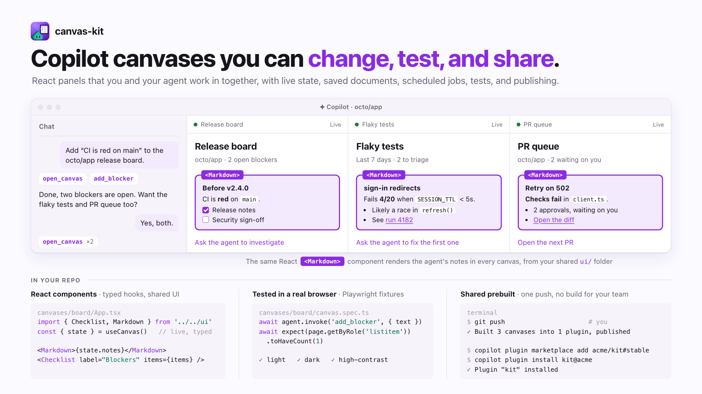

# rwoll/mono-oss

Open source tools, `@rwoll` npm packages, and Copilot plugins by [@rwoll](https://github.com/rwoll).

## What's here

Tools for working with coding agents, especially GitHub Copilot: give the agent a safe place to try
things, have it show you what it found, and build the panels you and it work in together.

| Project | What it does for you | Get it |
| --- | --- | --- |
| [**Blobby Sandbox**](packages/blobby-sandbox#readme) | Gives your agent a disposable Linux desktop to test on, set up by a recipe, that it can see, drive, and record, away from your own apps and accounts. | [`@rwoll/blobby-sandbox`](https://www.npmjs.com/package/@rwoll/blobby-sandbox) (early) |
| [**annotate**](packages/annotate#readme) | Turns screenshots and recordings into ones that explain themselves: numbered steps, zoom, captions, before/after, and redaction, from one JSON document. | [`@rwoll/annotate`](https://www.npmjs.com/package/@rwoll/annotate) |
| [**canvas-kit**](packages/canvas-kit#readme) | Builds Copilot canvases, the interactive panels you and your agent share, in TypeScript and React, with tests and one-push publishing. | [`@rwoll/canvas-kit`](https://www.npmjs.com/package/@rwoll/canvas-kit), [`@rwoll/create-canvas`](packages/create-canvas#readme) |

Each one also comes as a Copilot plugin, and there are two more plugins for everyday chats; see
[Copilot plugins](#copilot-plugins).

They work together. An agent reproduces a bug in a Blobby sandbox and records it, annotate turns the
recording into a clip that explains itself for the pull request, and both have canvases, built with
canvas-kit, where you watch and adjust their work.

## Blobby Sandbox


**Give your agent a real desktop to test on.** Checking a UI change means clicking through an app the way a
person would. Doing that on your own computer puts your apps, accounts, and tokens within the agent's reach.
Each Blobby sandbox is a fresh Linux machine instead: set up the same way every time by a recipe, signed in
only to a test account you allowlist, and thrown away when the agent is done. It runs as micro-VMs on your
Mac or Linux box, on Docker, or on Azure.

<picture>
  <source media="(prefers-color-scheme: dark)" srcset="docs/blobby-sandbox/hero-dark.png">
  
</picture>

```sh
blobby-sandbox start demo --recipe desktop    # a clean GNOME desktop
blobby-sandbox screenshot demo -o demo.png    # what the agent sees
blobby-sandbox view demo                      # or watch it live in your browser
```

It's early. See the [Blobby Sandbox guide](packages/blobby-sandbox#readme) to install it and sign VS Code
Insiders in to a test account.

## annotate


**Screenshots and screen recordings that explain themselves.** Describe the marks
once, in JSON: numbered steps, zoom that follows the action, captions, a
before/after wipe, and redaction. Render it to PNG, MP4, or GIF, or review it with
your agent in a Copilot canvas.

<picture>
  <source media="(prefers-color-scheme: dark)" srcset="docs/annotate/hero-dark.png">
  
</picture>

```sh
npm install -g --registry=https://registry.npmjs.org/ --min-release-age=7 --min-release-age-exclude='@rwoll/*' @rwoll/annotate@latest
annotate render bug.annotate.json -o bug.png
```

See the [annotate guide](packages/annotate#readme) for examples and the format.

## canvas-kit


**Copilot canvases you can change, test, and share.** Build the release boards,
triage queues, and review tools that you and your agent work in together: state
and actions in TypeScript, UI in React, and canvas-kit handles the rest.

<picture>
  <source media="(prefers-color-scheme: dark)" srcset="docs/canvas-kit/hero-dark.png">
  
</picture>

```sh
npm create @rwoll/canvas my-canvases -- --repository me/my-canvases --canvas board
```

See the [canvas-kit guide](packages/canvas-kit#readme) for the API.

## Copilot plugins

Add the marketplace once, then install any of these:

```sh
copilot plugin marketplace add rwoll/mono-oss#stable
copilot plugin install annotate@rwoll
```

| Plugin | What you get |
| --- | --- |
| [`annotate`](marketplace/canvases/annotate) | A canvas to play, adjust, and export annotated screenshots and recordings, and a skill that teaches the agent the format. |
| [`blobby-sandbox`](marketplace/canvases/blobby-sandbox) | A canvas to start, watch, and drive sandboxes, and a skill for the `blobby-sandbox` CLI. Needs the CLI installed. |
| [`canvas-kit`](marketplace/plugins/canvas-kit) | Skills for building, testing, and publishing your own canvases. |
| [`session-summary`](marketplace/canvases/session-summary) | A canvas with an executive summary of the chat that the agent keeps up to date, so you can check on long work at a glance. |
| [`pr-descriptions`](marketplace/plugins/pr-descriptions) | A skill for short, reader-first pull request titles and descriptions. |

## Issues and contributions

This repository is a read-only mirror, published from a private monorepo, so
pull requests are turned off and every commit here is an automated export. Bug
reports and ideas are welcome as [issues](https://github.com/rwoll/mono-oss/issues).

## Development

Requires Node.js 24 and pnpm (the version in `package.json`'s `packageManager`).

```sh
pnpm install
pnpm check   # build, typecheck, lint, and test every package
```

Dependencies come from the public npm registry. pnpm installs only versions
published at least 7 days ago (`@rwoll` packages excepted) and never runs
dependency install scripts; see [pnpm-workspace.yaml](pnpm-workspace.yaml).

New packages start from [`packages/hello`](packages/hello), which shows the
layout every `@rwoll` package uses.

## Releases

Each package is versioned and released on its own, with tags such as
`canvas-kit@0.3.0`, and the marketplace publishes on every push. See
[RELEASING.md](RELEASING.md).

## License

[MIT](LICENSE)
