Open source tools, `@rwoll` npm packages, and a Copilot plugin by [@rwoll](https://github.com/rwoll).

<picture>
  <source media="(prefers-color-scheme: dark)" srcset="docs/home/hero-dark.png">
  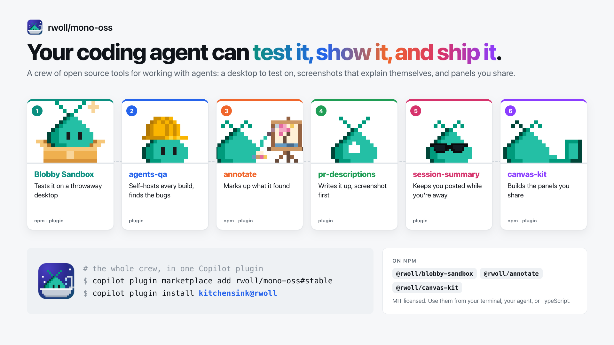
</picture>

Install the Copilot plugin, with every skill and canvas below:

[](https://vscode.dev/redirect?url=vscode%3A%2F%2Fchat-plugin%2Finstall%3Fsource%3DcndvbGwvbW9uby1vc3Mjc3RhYmxl%26plugin%3Dkitchensink)
[](https://vscode.dev/redirect?url=vscode-insiders%3A%2F%2Fchat-plugin%2Finstall%3Fsource%3DcndvbGwvbW9uby1vc3Mjc3RhYmxl%26plugin%3Dkitchensink)

```sh
copilot plugin marketplace add rwoll/mono-oss#stable
copilot plugin install kitchensink@rwoll
```

<table>
  <tr>
    <td align="center" width="166"><a href="#pr-descriptions">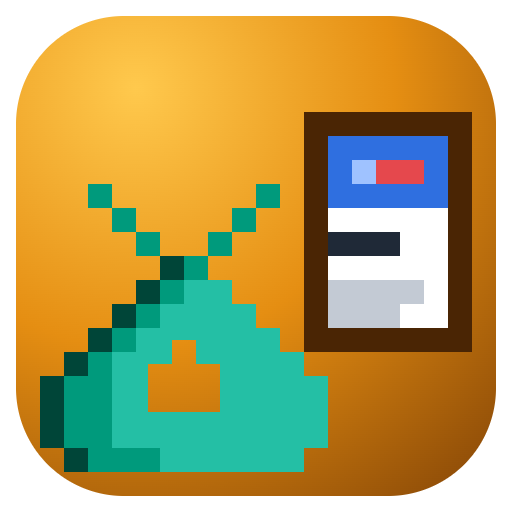<br><b>pr-descriptions</b></a><br>skimmable PRs</td>
    <td align="center" width="166"><a href="#annotate">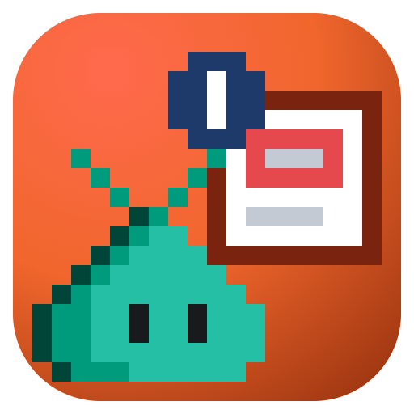<br><b>annotate</b></a><br>marked-up media</td>
    <td align="center" width="166"><a href="#agents-qa">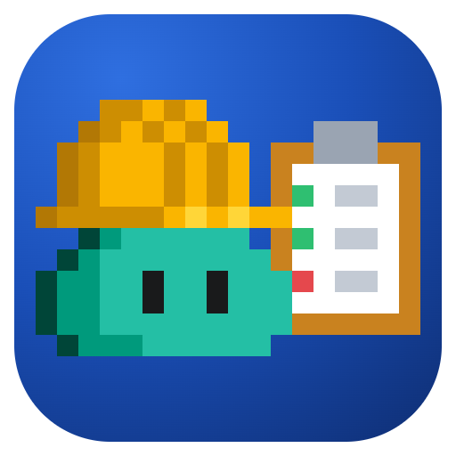<br><b>agents-qa</b></a><br>daily QA</td>
    <td align="center" width="166"><a href="#session-summary">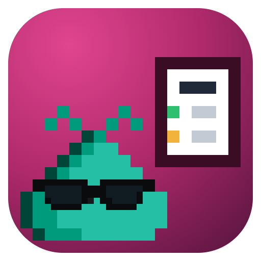<br><b>session-summary</b></a><br>status at a glance</td>
    <td align="center" width="166"><a href="#canvas-kit">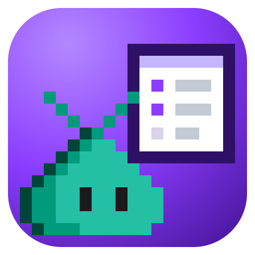<br><b>canvas-kit</b></a><br>build canvases</td>
    <td align="center" width="166"><a href="#blobby-sandbox">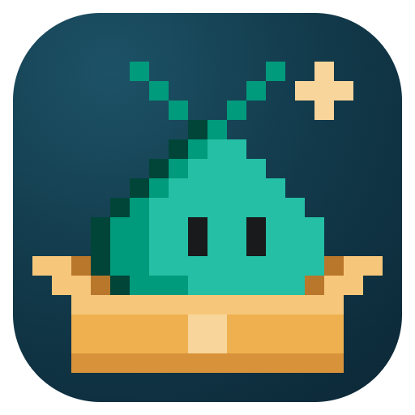<br><b>Blobby Sandbox</b></a><br>test desktops</td>
  </tr>
</table>

They work together. An agent reproduces a bug in a Blobby sandbox and records it, annotate turns the
recording into a clip that explains itself for the pull request, and both have canvases, built with
canvas-kit, where you watch and adjust their work.

## pr-descriptions

<picture>
  <source media="(prefers-color-scheme: dark)" srcset="docs/pr-descriptions/hero-dark.png">
  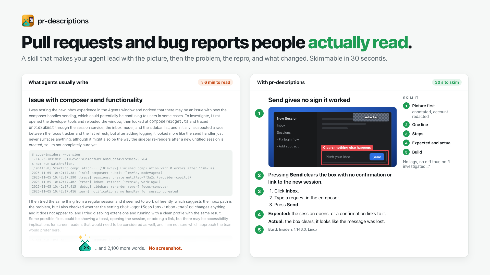
</picture>

**Pull requests and bug reports people actually read.** Agents write walls of text: what they
investigated, every file they touched, the test log. Reviewers look at the picture first. This skill
has your agent lead with an annotated, redacted screenshot or short video, then one line, the repro,
and what changed.

Real ones, written by an agent with this skill:

| Sample | What to look at |
| --- | --- |
| [microsoft/vscode#346308](https://github.com/microsoft/vscode/issues/346308) | A bug report: before and after screenshots first, then one line, steps, expected and actual |
| [microsoft/vscode#346311](https://github.com/microsoft/vscode/issues/346311) | A bug report that shows the broken case next to the working one |
| [microsoft/vscode#346327](https://github.com/microsoft/vscode/issues/346327) | A feature request that opens with the screenshot |
| [microsoft/vscode#346195](https://github.com/microsoft/vscode/pull/346195) | A short pull request: summary, repro, and a before/after table |

It comes in the [Copilot plugin](#copilot-plugin). The [rules](marketplace/skills/pr-descriptions/SKILL.md)
and [more examples](marketplace/skills/pr-descriptions/references/examples.md) are in the skill.

## annotate

<picture>
  <source media="(prefers-color-scheme: dark)" srcset="docs/annotate/hero-dark.png">
  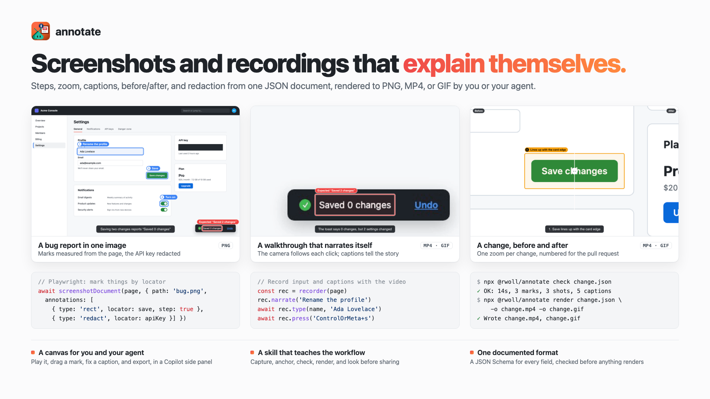
</picture>

**Screenshots and screen recordings that explain themselves.** Describe the marks
once, in JSON: numbered steps, zoom that follows the action, captions, a
before/after wipe, and redaction. Render it to PNG, MP4, or GIF, or review it with
your agent in a Copilot canvas.

```sh
npm install -g --registry=https://registry.npmjs.org/ --min-release-age=7 --min-release-age-exclude='@rwoll/*' @rwoll/annotate@latest
annotate render bug.annotate.json -o bug.png
```

See the [annotate guide](packages/annotate#readme) for examples and the format.

## agents-qa

<picture>
  <source media="(prefers-color-scheme: dark)" srcset="docs/agents-qa/hero-dark.png">
  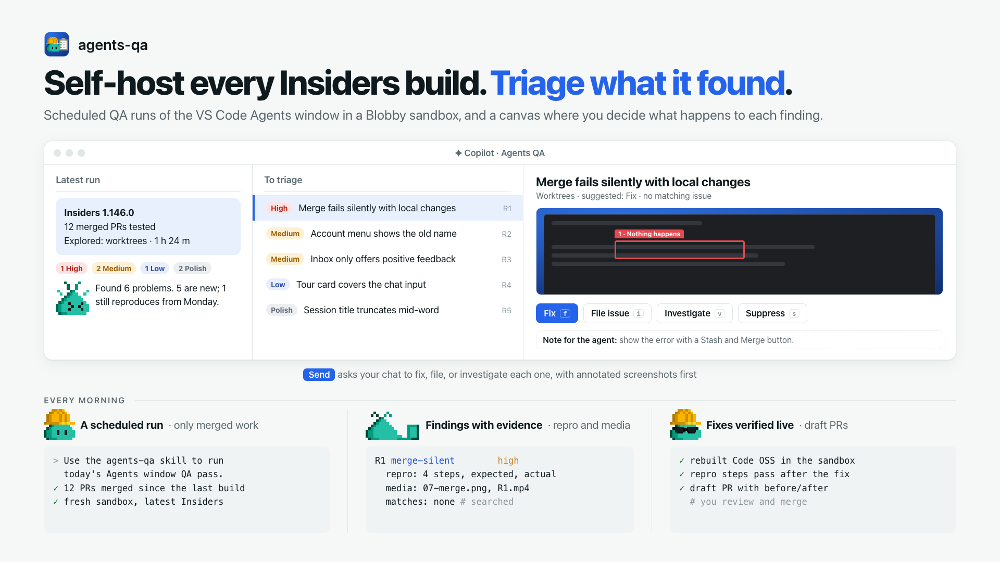
</picture>

**Self-host every Insiders build, and triage what it found.** A scheduled run tests the VS Code Agents
window pull requests merged since the last build in a fresh Blobby sandbox, and records each problem
with repro steps, screenshots, and matching issues. You decide in a canvas: fix, file, investigate, or
suppress, and your chat does the rest.

It comes in the [Copilot plugin](#copilot-plugin); see the [setup](marketplace/canvases/agents-qa#set-up-the-scheduled-run).

## session-summary

<picture>
  <source media="(prefers-color-scheme: dark)" srcset="docs/session-summary/hero-dark.png">
  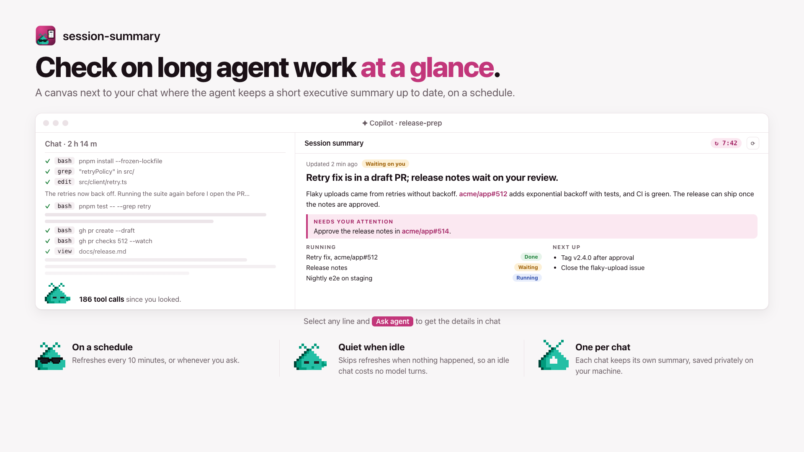
</picture>

**Check on long agent work at a glance.** Instead of scrolling hours of tool calls, open a canvas where
the agent keeps a short executive summary up to date: what's done, what's running, and what needs you.
It refreshes on a schedule and stays quiet when nothing happened.

It comes in the [Copilot plugin](#copilot-plugin). Ask your agent to open the `session-executive-summary` canvas.

## canvas-kit

<picture>
  <source media="(prefers-color-scheme: dark)" srcset="docs/canvas-kit/hero-dark.png">
  
</picture>

**Copilot canvases you can change, test, and share.** Build the release boards,
triage queues, and review tools that you and your agent work in together: state
and actions in TypeScript, UI in React, and canvas-kit handles the rest.

```sh
npm create @rwoll/canvas my-canvases -- --repository me/my-canvases --canvas board
```

See the [canvas-kit guide](packages/canvas-kit#readme) for the API.

## Blobby Sandbox

<picture>
  <source media="(prefers-color-scheme: dark)" srcset="docs/blobby-sandbox/hero-dark.png">
  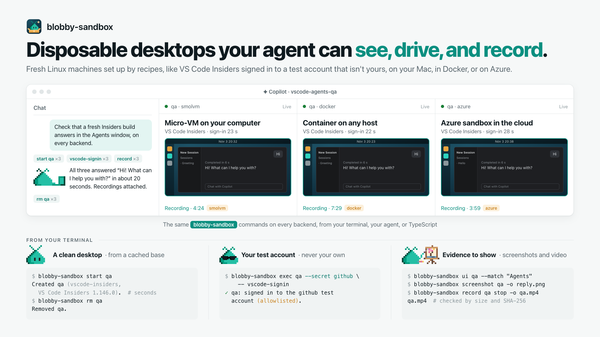
</picture>

**Give your agent a real desktop to test on.** Checking a UI change means clicking through an app the way a
person would. Doing that on your own computer puts your apps, accounts, and tokens within the agent's reach.
Each Blobby sandbox is a fresh Linux machine instead: set up the same way every time by a recipe, signed in
only to a test account you allowlist, and thrown away when the agent is done. It runs as micro-VMs on your
Mac or Linux box, on Docker, or on Azure.

```sh
blobby-sandbox start demo --recipe desktop    # a clean GNOME desktop
blobby-sandbox screenshot demo -o demo.png    # what the agent sees
blobby-sandbox view demo                      # or watch it live in your browser
```

It's early. See the [Blobby Sandbox guide](packages/blobby-sandbox#readme) to install it and sign VS Code
Insiders in to a test account.

## What's here

Tools for working with coding agents, especially GitHub Copilot: give the agent a safe place to try
things, have it show you what it found, and build the panels you and it work in together.

| Project | What it does for you | Get it |
| --- | --- | --- |
| [**annotate**](packages/annotate#readme) | Turns screenshots and recordings into ones that explain themselves: numbered steps, zoom, captions, before/after, and redaction, from one JSON document. | [`@rwoll/annotate`](https://www.npmjs.com/package/@rwoll/annotate) |
| [**canvas-kit**](packages/canvas-kit#readme) | Builds Copilot canvases, the interactive panels you and your agent share, in TypeScript and React, with tests and one-push publishing. | [`@rwoll/canvas-kit`](https://www.npmjs.com/package/@rwoll/canvas-kit), [`@rwoll/create-canvas`](packages/create-canvas#readme) |
| [**Blobby Sandbox**](packages/blobby-sandbox#readme) | Gives your agent a disposable Linux desktop to test on, set up by a recipe, that it can see, drive, and record, away from your own apps and accounts. | [`@rwoll/blobby-sandbox`](https://www.npmjs.com/package/@rwoll/blobby-sandbox) (early) |

### Skills and canvases

The `kitchensink` Copilot plugin bundles these, so your agent knows how to use each tool and you
get a panel to work in alongside it:

| Skill or canvas | Why |
| --- | --- |
| [`pr-descriptions`](marketplace/skills/pr-descriptions/SKILL.md) (skill) | Agents write walls of text. This has them write PR and bug report descriptions a person can skim in 30 seconds: the screenshot or video first, then the problem, repro, and what changed, and none of the validation logs or process narrative. |
| [`annotate`](marketplace/canvases/annotate) (skill and canvas) | A raw screenshot makes the reader hunt for the problem. The agent marks what matters, zooms, captions, and redacts accounts, and you adjust it in the canvas before it goes in a PR or issue. |
| [`agents-qa`](marketplace/canvases/agents-qa) (skill and canvas) | Self-hosting a fast-moving product daily is tedious. A scheduled run tests the VS Code Agents window PRs merged since the last build in a sandbox, and you triage what it found in the canvas: fix, file, investigate, or suppress. |
| [`session-summary`](marketplace/canvases/session-summary) (canvas) | Long agent sessions are hard to check on. The agent keeps a short executive summary up to date, so you can see where things stand at a glance. |
| [`canvas-kit`](marketplace/skills/canvas-kit/SKILL.md), [`-testing`](marketplace/skills/canvas-kit-testing/SKILL.md), [`-publishing`](marketplace/skills/canvas-kit-publishing/SKILL.md) (skills) | Teach the agent to build, test, and publish your own canvases with `@rwoll/canvas-kit`. |
| [`blobby-sandbox`](marketplace/canvases/blobby-sandbox) (skill and canvas) | Lets the agent test a UI change by actually clicking through it, on a throwaway desktop instead of your computer, and shows you what it's doing. Needs the [CLI](packages/blobby-sandbox#readme). |

## Copilot plugin

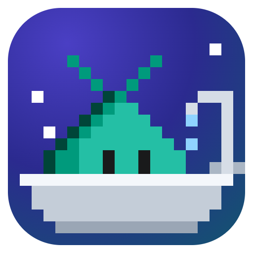

Everything but the kitchen sink, in one plugin:

```sh
copilot plugin marketplace add rwoll/mono-oss#stable
copilot plugin install kitchensink@rwoll
```

See [Skills and canvases](#skills-and-canvases) for what's in it.

## Issues and contributions

This repository is a read-only mirror, published from a private monorepo, so
pull requests are turned off and every commit here is an automated export. Bug
reports and ideas are welcome as [issues](https://github.com/rwoll/mono-oss/issues).

## Development

Requires Node.js 24 and pnpm (the version in `package.json`'s `packageManager`).

```sh
pnpm install
pnpm check   # build, typecheck, lint, and test every package
```

Dependencies come from the public npm registry. pnpm installs only versions
published at least 7 days ago (`@rwoll` packages excepted) and never runs
dependency install scripts; see [pnpm-workspace.yaml](pnpm-workspace.yaml).

New packages start from [`packages/hello`](packages/hello), which shows the
layout every `@rwoll` package uses.

## Releases

Each package is versioned and released on its own, with tags such as
`canvas-kit@0.3.0`, and the marketplace publishes on every push. See
[RELEASING.md](RELEASING.md).

## License

[MIT](LICENSE)
