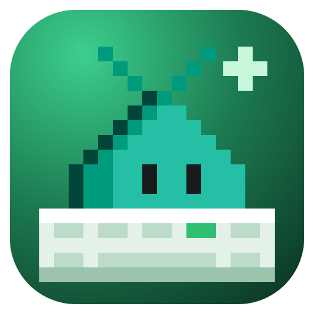
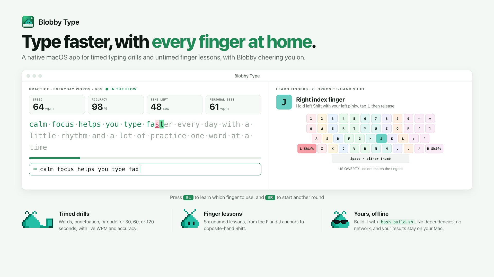

# Blobby Type

A native macOS typing workout, written in SwiftUI with **no third-party dependencies**.
Requires macOS 14 or newer. Everything runs offline.

<picture>
  <source media="(prefers-color-scheme: dark)" srcset="https://raw.githubusercontent.com/rwoll/mono-oss/main/docs/blobby-type/hero-dark.png">
  
</picture>

## Build and run

Install Xcode or Apple's Command Line Tools, then run:

```sh
bash build.sh
open "dist/Blobby Type.app"
```

The app builds for your Mac's architecture. To build for Intel on Apple Silicon,
use `ARCH=x86_64 bash build.sh`. Build output goes to `dist/`, which isn't committed.
No package manager, downloads, account, or Xcode project is needed.

## Practice

- Choose **Everyday words**, **Punctuation**, or **Code fingers**.
- Choose a **30, 60, or 120 second** workout. The first printable keystroke starts it.
- Type the prompt, including spaces shown as middle dots. Green is correct;
  pink marks a slip; the mint highlight is the next character.
- Use **Backspace** to correct your last character. Paste and drag-and-drop are disabled.
- Prompts continue automatically if you fill a page before time runs out.
- **Command-R** restarts. **Return** starts another round after the result.
- Set a WPM stretch goal in the sidebar. **Your progress** shows completed runs;
  **Command-Shift-H** opens it.
- The timer continues if you leave the app. Unfinished/restarted runs aren't saved.

## Learn proper finger use

Choose **Learn fingers** in the sidebar, or press **Command-L**.
This mode is untimed: slow, correct movement is the goal, not WPM.

Six repeatable lessons cover F/J anchors, home row, upper-row and lower-row
reaches, numbers, and opposite-hand Shift. The keyboard and hand diagram share
finger colors. The next key, assigned finger, and any required Shift hand are
highlighted together. Return the reaching finger to its home key afterward.

Wrong keys don't advance the lesson; correct keys do. Backspace lets you
revisit the previous character. **Command-R** repeats the current lesson;
**Return** moves to the next lesson after completion. Practiced lessons are
saved locally, separately from timed WPM history. Switching to Learn fingers
discards an unfinished timed run.

The mapping assumes a **US QWERTY keyboard**. The app cannot detect which physical
finger you use, and completing a lesson does not certify your technique.
Repeat until you can use the suggested fingers without looking down.
Keep shoulders relaxed and wrists neutral; don't force uncomfortable reaches.

## Sound effects

Quiet key taps, a low mistake tone, and a short completion chime are generated
in Swift and played using Apple's `NSSound`. No audio assets or downloads are
needed. **Sound on / Muted** at the bottom toggles all effects and remembers
your preference. Sounds follow your Mac's output volume and audio device.

**WPM** = currently correct characters (including spaces) / 5 / elapsed minutes.
**Accuracy** = correct insertion attempts / all insertion attempts. Correcting a
mistake improves WPM but doesn't erase the original mistake from accuracy.
Personal best and the trend compare only runs with the same mix and duration.

The last 100 finished runs and your preferences are saved using Apple's
`UserDefaults`, on this Mac only. The app follows your Mac's light/dark appearance.
There is no analytics, network code, or third-party SDK.

## Verify

```sh
bash test.sh
```

Tests compile with Apple's tools and use no testing dependencies.

For offscreen native UI previews and an input-wiring smoke test:

```sh
bash preview.sh
bash preview.sh --fingers
```

Add `--sound-check` to play and verify the three sound effects.

Light/dark, active, completed, history, minimum-size, drill, and finger-lesson previews are
written to `$TMPDIR/blobby-type-previews`. This doesn't open a desktop window
or modify your practice history.

## Artwork

Official Blobby Insiders sprites from [microsoft/vscode](https://github.com/microsoft/vscode),
displayed without smoothing at 1.5x or 2x scale.
Their MIT license is included in [Resources/LICENSE-blobby-sprites.txt](Resources/LICENSE-blobby-sprites.txt)
and copied into the app bundle.
