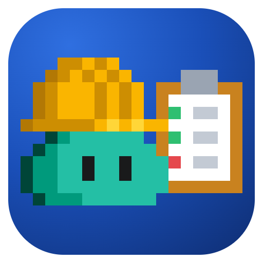
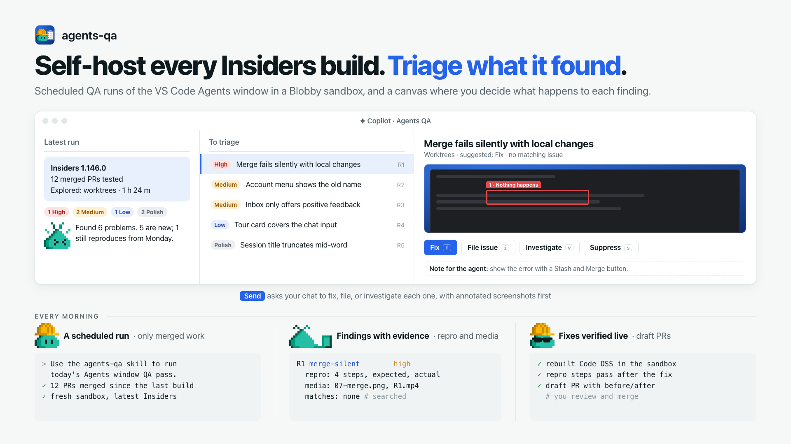

# Agents QA

Scheduled QA runs of the VS Code Agents window, and a canvas to triage what they find.

<picture>
  <source media="(prefers-color-scheme: dark)" srcset="https://raw.githubusercontent.com/rwoll/mono-oss/main/docs/agents-qa/hero-dark.png">
  
</picture>

- The **`agents-qa` skill** runs an unattended QA pass. It starts a fresh desktop sandbox with [`@rwoll/blobby-sandbox`](https://github.com/rwoll/mono-oss/tree/main/packages/blobby-sandbox), with VS Code Insiders updated to the latest build and signed in to the GitHub test account. It then self-hosts the user-facing `microsoft/vscode` pull requests merged since the last run, plus one exploratory area that rotates between runs, looking for bugs, visual inconsistencies, and friction for people who don't code. Every finding gets repro steps, screenshots, a recording, matching GitHub issues, and a suggested decision. It never files, comments, or opens pull requests itself.
- The **Agents QA canvas** (`rwoll-agents-qa`) shows those findings. You decide what happens to each one, then **Send** asks the agent in your chat to carry out the decisions.

It ships in the `kitchensink` plugin, with both the skill and the canvas, next to the `blobby-sandbox`, `annotate`, and `pr-descriptions` skills that runs and filed issues and PRs use.

## Set up the scheduled run

1. Install the plugin:

   ```sh
   copilot plugin marketplace add rwoll/mono-oss#stable
   copilot plugin install kitchensink@rwoll
   ```

2. Install the `blobby-sandbox` CLI and set up the test account once, as its [README](https://github.com/rwoll/mono-oss/tree/main/packages/blobby-sandbox#use-it-with-vs-code-insiders) describes: `blobby-sandbox doctor` should pass, with the `github` secret set (`blobby-sandbox secrets set github`) and the account's login in `allowedLogins`. Use a dedicated account, never your own.
3. In the Agents window, create an automation that runs on a schedule, for example every weekday morning, with this prompt:

   > Use the agents-qa skill to run today's Agents window QA pass.

   Give it a permission mode that lets it run `blobby-sandbox` and `gh` commands unattended. A run takes about an hour and a half; add "Spend at most 45 minutes testing." to the prompt for a shorter one, or "Explore Automations." to pick the area.

## The QA folder

Runs and decisions live in `~/agents-window-qa`, or in `$AGENTS_QA_ROOT` when that is set for both the automation and VS Code:

```text
runs/<run>/findings.json    a run, written by the skill (format: skills/agents-qa/references/findings-format.md)
runs/<run>/REPORT.md        its report, with screenshots inline
runs/<run>/prs.json         the PRs in its build and not the last run's, from scripts/pick-prs.ts
triage.json                 your decisions, written by the canvas
requests/                   what each Send asked the agent to do
outcomes/                   results that fix and investigation sessions report; the canvas merges them
investigations/, fixes/     investigation reports and after screenshots
```

Each run records the build it tested (version and commit), the build its PR list starts from, the PRs it tested, the PRs it verified working, and every other PR in the build with why it was skipped. A run's PRs are those in its build and not the last run's, so none fall between runs. A later run reads `triage.json`. It never reports a suppressed finding again, and it re-checks findings that should be fixed.

## Triage

Open the canvas in a chat you use for triage:

> Open the `rwoll-agents-qa` canvas.

- The purple box summarizes the latest run: build, pull requests tested, the area explored, and counts. **Report** opens its `REPORT.md`, and the run picker limits the list to one run.
- **To triage** lists findings without a decision, most severe first. A finding seen in several runs appears once, described by the newest run. Select one to see its summary, repro steps, screenshots and recording, related pull requests, existing issues, and suggested owner.
- Decide with the buttons or keys (`j` and `k` move):

  | Decision | Key | What happens |
  | --- | --- | --- |
  | **Fix** | `f` | A session (Opus 5.5 by default) in a new worktree of your `microsoft/vscode` checkout reproduces the bug, fixes it, verifies the fix live in a desktop, and opens a **draft** PR. The PR leads with an annotated before/after, then repro steps and at most a sentence of root cause. |
  | **File issue** | `i` | Your chat files a minimal issue: the key screenshot or recording first, annotated and redacted, then repro steps, expected and actual, assigned to the owner, with the `bug` label. It checks for a duplicate first. |
  | **Investigate** | `v` | A session finds the root cause and whether it's a regression, without changing code, and writes a report. |
  | **Tracked** | | An existing issue covers it. Pick one of the matches or paste a URL. |
  | **Suppress** | `s` | Not a bug or not worth fixing. Later runs don't report it again. |

  After you decide, the next finding is selected. **Use N suggestions** takes the run's suggestion for every finding you haven't decided.
- **Note for the agent** is passed on with the decision, for example "show the error with a button that fixes it".
- **Send N to agent** asks your chat's agent, with one `[agents-qa-triage:…]` message, to carry out every ready Fix, File issue, and Investigate decision. The details go in a request file under `requests/`, and finding text is fenced as data, not instructions. The chat starts sessions for fixes and investigations, files issues itself, and records each result with `record_outcome`. Sessions report back by writing a file to `outcomes/`, which the canvas picks up within 20 seconds.
- **In progress** and **Done** show what came of each decision: the session, the draft PR, the issue, or the report. PR and issue links show their state (draft, open, merged, closed) from the `gh` CLI. **Reset** or **Try again** puts a decision back so it can be changed or sent again.
- **⋯** sets the model for fix and investigation sessions and the `microsoft/vscode` checkout they use (default `~/code/vscode`).

Every chat with the canvas open shows the same decisions; changes are saved under a lock, so none are lost.

## Actions

| Action | Who | Does |
| --- | --- | --- |
| `decide` | agent, UI | Sets a finding's decision: `fix`, `issue`, `investigate`, `tracked` (with `trackedUrl`), `suppress`, or `null`. |
| `set_note` | agent, UI | Saves the note passed on with the decision. |
| `record_outcome` | agent | Records the result of a sent decision: `working`, `done`, or `failed`, with links and detail. |
| `configure` | agent, UI | Sets `fixModel` and `vscodePath`. |
| `get_state` | agent | Returns runs, findings with their decisions, settings, and problems. |
| `sync`, `accept_suggestions`, `send`, `reset`, `open_file`, `open_link` | UI | Re-read the folder, take suggestions, send decisions, reset one, and open files and links. |

## Safety

- The page shows only images and videos inside the QA folder, by their real paths, through the canvas kit's token-checked files route. **Report** and other files open only from inside the QA folder, and anything that could run opens in its folder instead.
- Run text comes from an agent that read the Agents window and GitHub, so it is shown without HTML and passed to agents as fenced data. Your notes are passed as your instructions.
- The run tests only PRs by repository members, reads only members' comments and reviews, and treats what it reads and sees in the sandbox as untrusted.
- The scheduled run only reports. Filing issues, opening pull requests, and starting sessions happen only after you Send.

## Develop

From `marketplace`:

```sh
AGENTS_QA_ROOT=/tmp/qa pnpm dev    # the UI with live canvas logic, against a test QA folder
pnpm test                          # unit tests, including the skill's scripts
pnpm build                         # the whole marketplace in dist/marketplace
```

`format.ts` defines the files the skill and canvas share; keep it, [findings-format.md](https://github.com/rwoll/mono-oss/blob/main/marketplace/skills/agents-qa/references/findings-format.md), and [check-run.ts](https://github.com/rwoll/mono-oss/blob/main/marketplace/skills/agents-qa/scripts/check-run.ts) in step. `vite.config.ts` ships the skill in the `kitchensink` plugin, and its scripts run with Node.js 24.
