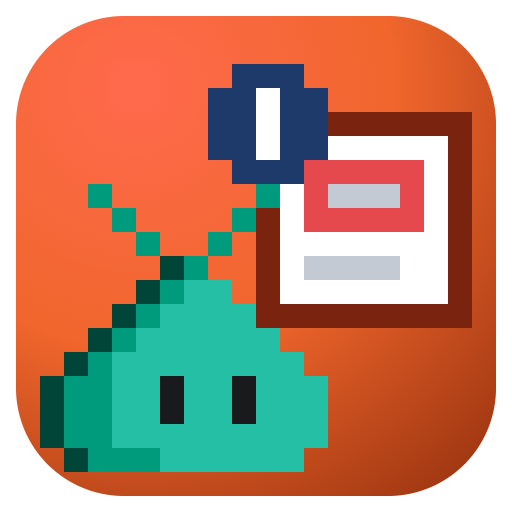

# annotate

A canvas for annotate documents: marks, zoom, captions, before/after, and redaction
on a screenshot or screen recording, made with [`@rwoll/annotate`](https://github.com/rwoll/mono-oss/tree/main/packages/annotate).
The agent opens it with a document (or an image or video to start one), and you
play it, fix marks by dragging them, edit labels and captions, and export.

```sh
copilot plugin marketplace add rwoll/mono-oss#stable
copilot plugin install annotate@rwoll
```

- **The file is the source of truth.** Every edit is saved to the document file, and
  edits made to the file outside the canvas show up within two seconds.
- **Export** renders with the `annotate` command on PATH, next to the document as
  `<name>-annotated.<format>` (never over the original), then tells the agent where
  the file is. It needs the version the canvas was built with or later; if it's
  missing or older, the canvas says so, and the annotate skill's
  `scripts/install-tools.ts` installs the latest. Video needs ffmpeg. Set
  `ANNOTATE_CLI` to use another annotate command or a checkout's `bin/annotate.js`.
- **Ask the agent** sends your note, and the selected annotation, to the chat.

The plugin also ships the [annotate skill](https://github.com/rwoll/mono-oss/blob/main/marketplace/skills/annotate/SKILL.md), which teaches
the agent the document format and workflow.
