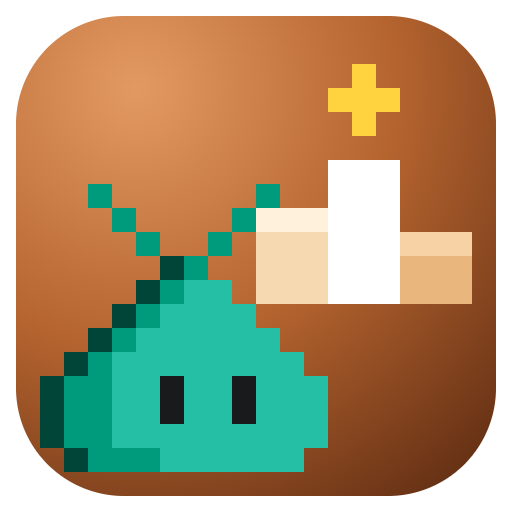
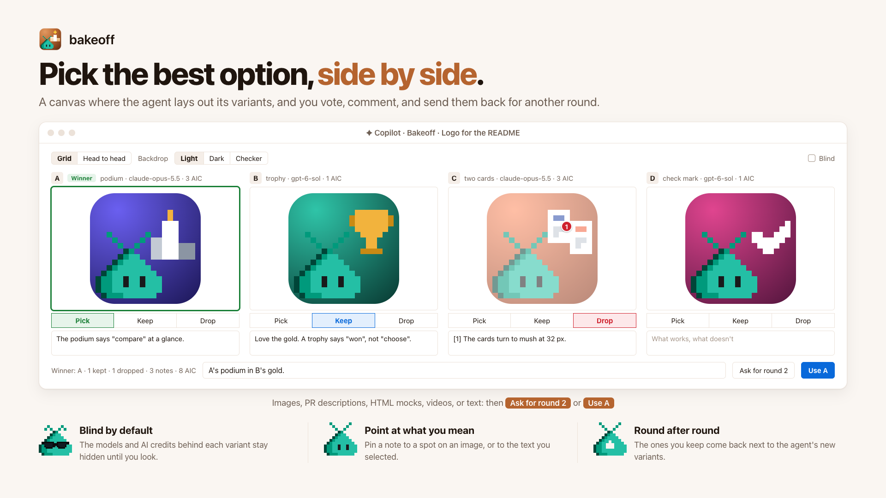
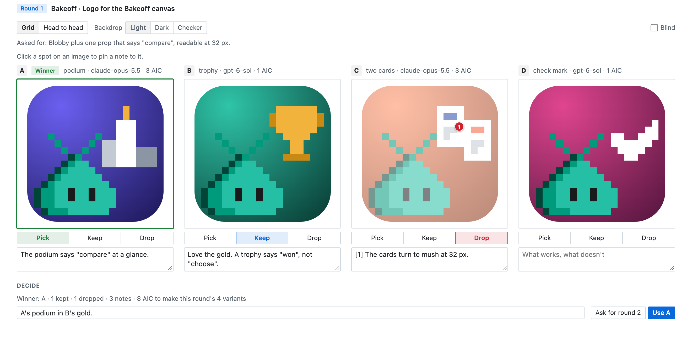
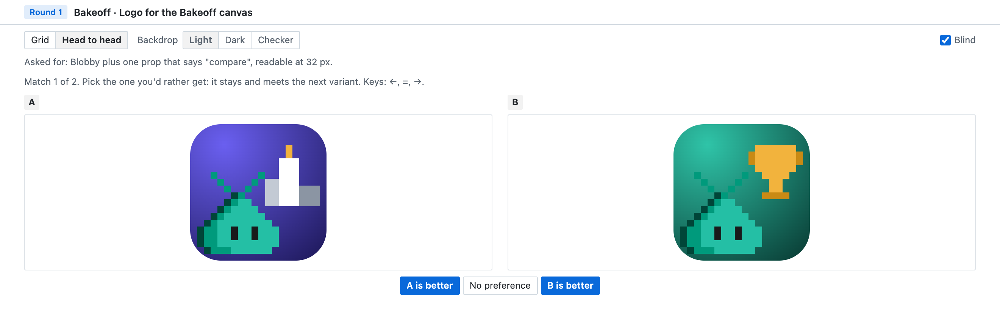
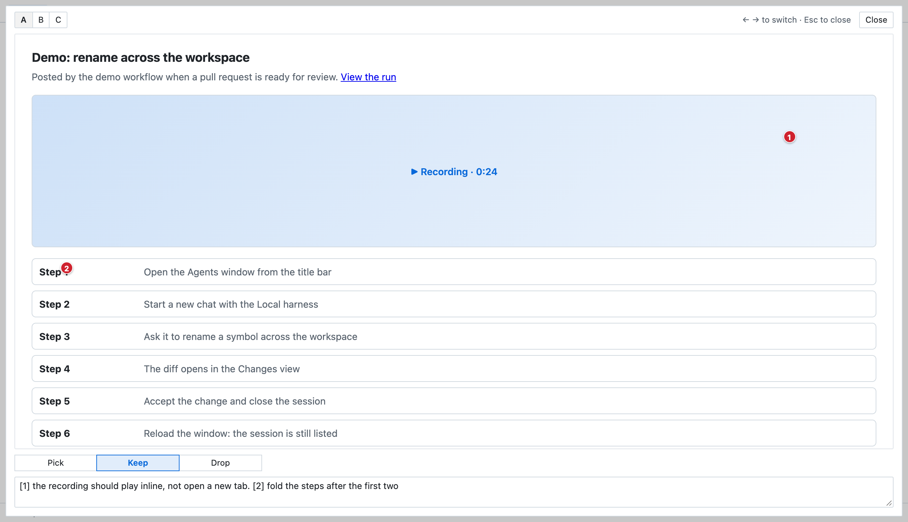
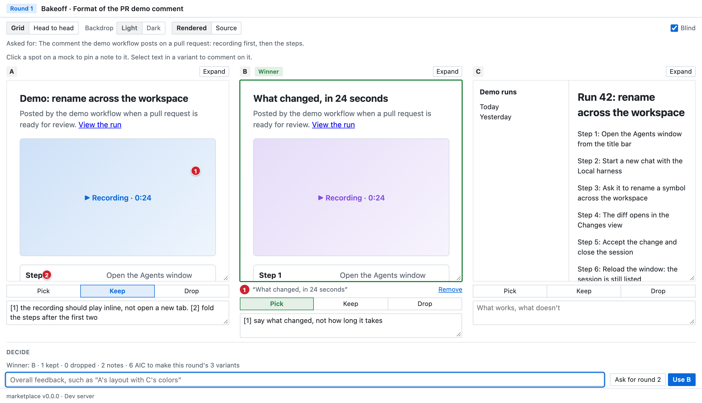
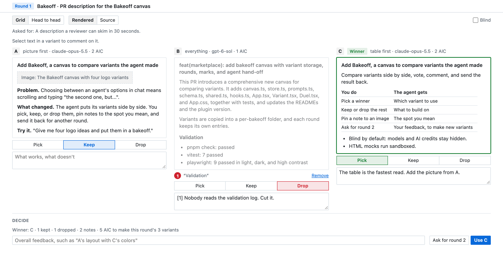

# Bakeoff

Compare variants the agent made, vote, comment, and send the result back. Canvas
ID: `rwoll-bakeoff`, in the `kitchensink` plugin. Built with
[`@rwoll/canvas-kit`](https://github.com/rwoll/mono-oss/tree/main/packages/canvas-kit).

<picture>
  <source media="(prefers-color-scheme: dark)" srcset="https://raw.githubusercontent.com/rwoll/mono-oss/main/docs/bakeoff/hero-dark.png">
  
</picture>

```sh
copilot plugin marketplace add rwoll/mono-oss#stable
copilot plugin install kitchensink@rwoll
```

Ask the agent for several options of something, and to put them in a bakeoff:

> Give me four logo ideas for this project and put them in a bakeoff.

It works for images (PNG, JPEG, GIF, WebP, AVIF, SVG), videos (MP4, WebM, MOV),
Markdown such as pull request descriptions, HTML mocks, and plain text.

The plugin's [`bakeoff` skill](https://github.com/rwoll/mono-oss/blob/main/marketplace/skills/bakeoff/SKILL.md)
tells the agent how to make the variants fairly: one brief, one sub-agent per
variant, none seeing the others. To compare models, name them:

> Bake off a PR description for this branch on claude-opus-5.5 and gpt-6-sol.

## Review a round

<picture>
  <source media="(prefers-color-scheme: dark)" srcset="https://raw.githubusercontent.com/rwoll/mono-oss/main/docs/bakeoff/canvas-dark.png">
  
</picture>

- **Grid.** Variants sit side by side, lettered A, B, C. A letter never changes, so
  "A's layout with C's colors" means the same thing in every round.
- **Pick, Keep, Drop.** One variant is the winner; picking another turns the old
  winner into a keep. Kept variants come along to the next round; dropped ones do not.
- **Notes.** Say what works and what doesn't for each variant, and for the round as
  a whole. Click a spot on an image or an HTML mock to pin a numbered note to it,
  or select text in a Markdown, text, or HTML variant and choose **Comment on the
  selected text**. The note gets `[1]`, `[2]` to refer to them, and the agent is
  told what a pin on a mock is on, such as `<button> Record again`.
- **Head to head.** Two variants at a time, with no votes or notes in sight: the one
  you'd rather get stays and meets the next, so four variants take three matches
  (`←`, `=`, `→`). Dropped variants sit out, and the last one standing becomes the
  winner. The two share the whole panel, and each scrolls in its own half.
- **Expand.** Shows one variant alone, as large as the panel allows, from the grid
  or head to head. `←` and `→` switch to the next variant, and `Esc` closes it.
  From the grid it has the variant's vote and note below it, to pin and quote at
  full size.
- **Blind.** On by default: it hides the models, AI credits, and approach behind
  each variant, so they don't sway you. Turn it off to see them, such as
  `chart in a card · claude-opus-5.5 · 3 AIC`. The round's total credits always show.
- **Backdrop and source.** Put images, videos, and HTML mocks on a light, dark, or
  checkered backdrop, and switch Markdown and HTML between rendered and source.

Head to head shows two variants and nothing else, as tall as the panel:



**Expand** gives one variant the whole panel:



A click on an HTML mock pins a note to that spot, and selected text can be quoted:



Markdown variants are rendered, and a note can quote the text it is about:



## Decide

- **Ask for round N** sends your votes and notes to the agent in your chat, in a
  message that starts with `[bakeoff:next-round]`. Its new variants start the next
  round, next to the ones you kept. Earlier rounds stay in the **Round** menu, as
  what you decided, with nothing to change.
- **Use A** tells the agent to use the winner, with the changes your notes ask
  for, in a message that starts with `[bakeoff:use]`.

## What the agent does

It opens the canvas with a title and a brief, and a short `id` when the chat has
more than one bakeoff going; the same `id` opens the same bakeoff from any chat.

| Action | What it does |
| --- | --- |
| `add_variants` | Add up to 12 variants, each a file (`path`) or text (`content`), with what made it when the agent knows: `approach`, `models`, and `credits` (AI credits). After you asked for another round, this starts it. |
| `get_state` | The variants, and each round's votes, notes, pins, and quotes. |
| `vote` | Vote for you, when you say so in chat. |

```json
{
  "variants": [
    { "path": "/tmp/logos/chart.png", "approach": "chart in a card", "models": ["claude-opus-5.5"], "credits": 3 },
    { "content": "## Add the canvas\n\n…", "approach": "picture first" }
  ]
}
```

A bakeoff holds up to 78 variants over all its rounds.

## Files and safety

- The canvas copies every variant into the bakeoff's folder,
  `<copilot-home>/extension-data/rwoll-bakeoff/bakeoffs/<id>/round-<n>/`, so it
  still works after the agent's scratch files are gone. `feedback.md` next to them
  is what you sent for that round.
- An HTML mock runs in a sandboxed frame: no scripts, forms, or navigation, and it
  cannot load anything from the network, so it can only draw. The canvas can see
  into the frame, to pin your clicks, quote your selection, and give the mock the
  height it needs. Interactive mocks show their first state.
- Markdown is rendered without HTML, and images in it show as labeled
  placeholders. An SVG is shown as an image, where it cannot run scripts.

## Develop

From `oss/marketplace`:

```sh
pnpm dev                                  # every canvas in a browser
pnpm exec vitest run canvases/bakeoff
pnpm build && pnpm e2e canvases/bakeoff
```

- `canvas.ts`: state and actions. `store.ts`: the bakeoff's folder. `prompts.ts`:
  what the agent is told. `schema.ts` and `shared.ts`: the state and its names.
- `App.tsx`, `Variant.tsx`, `Duel.tsx`, and `App.css`: the React UI.
