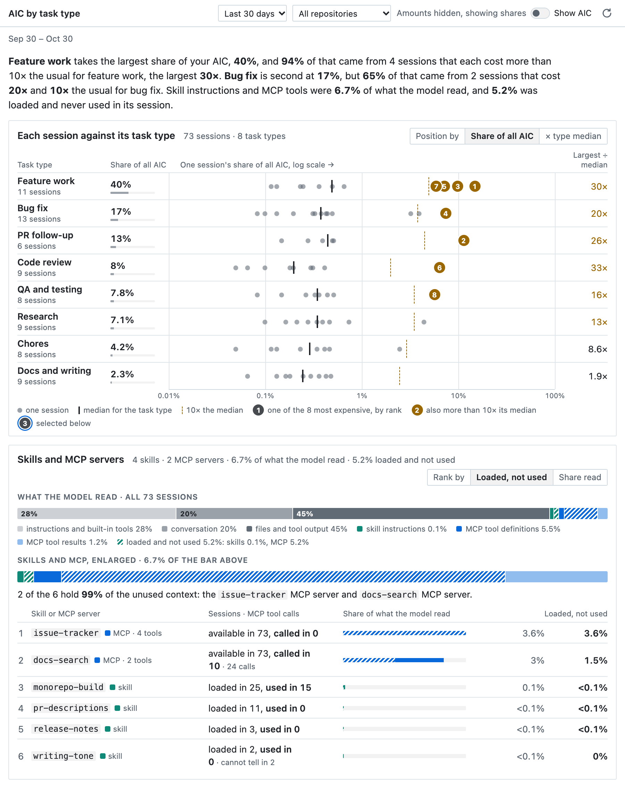
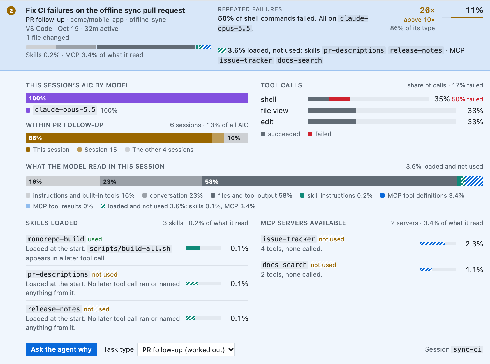

# Copilot spend

Shows which kinds of tasks your Copilot AI credits (AIC) go to, which sessions are
behind the numbers, and which skills and MCP servers take context without being
used. Canvas ID: `rwoll-copilot-spend`, in the `kitchensink` plugin. Built with
[`@rwoll/canvas-kit`](https://github.com/rwoll/mono-oss/tree/main/packages/canvas-kit).

<picture>
  <source media="(prefers-color-scheme: dark)" srcset="https://raw.githubusercontent.com/rwoll/mono-oss/main/docs/copilot-spend/canvas-dark.png">
  
</picture>

```sh
copilot plugin marketplace add rwoll/mono-oss#stable
copilot plugin install kitchensink@rwoll
```

Ask the agent to open it:

> Open the Copilot spend canvas.

It reads the session logs Copilot keeps on this machine, in the `session-state`
folder of Copilot's home (`~/.copilot`, or `$COPILOT_HOME`). Nothing leaves the
machine. The first read of a month of sessions takes a few seconds; after that,
only logs that changed are read again.

## Amounts are hidden by default

AIC amounts can be sensitive, so the canvas opens showing shares only: percentages,
ranks, and multiples such as "26× the median for its task type". No amount, token
count, or count of model calls is on the page, and none is in the state the agent
reads. Turn on **Show AIC** to see amounts. Only you can: the agent has no action
for it.

## What it shows

- **Each session against its task type.** One row per task type, with its share of
  all AIC, and one dot per session on a log scale. A line marks the type's median
  session and a dashed line 10× the median; the 8 most expensive sessions are
  numbered, in orange when they are past that line. Switch **Position by** to place
  sessions by their multiple of the median instead.
- **Skills and MCP servers.** What the model read in all sessions, by where it came
  from: instructions and built-in tools, conversation, files and tool output, skill
  instructions, MCP tool definitions, and MCP tool results. The hatched part was
  loaded and not used in its session. The table ranks each skill and MCP server by
  that part, or by its whole share: how many sessions loaded it, and how many used it.
- **Most expensive sessions.** For each: what set it apart (repeated failures,
  sub-agents, unused context, rereading files, a large context, a long session, or
  the model), its multiple of its task type's median, what the model read in it,
  and the skills and MCP servers it had and did not use.

Select a session, in the picture or the list, to open it:

<picture>
  <source media="(prefers-color-scheme: dark)" srcset="https://raw.githubusercontent.com/rwoll/mono-oss/main/docs/copilot-spend/session-dark.png">
  
</picture>

- **Ask the agent why** asks the agent in your chat to look into the session's log
  and say what it was doing when it spent the most, in a message that starts with
  `[copilot-spend:session]`. While amounts are hidden, the agent is told to give
  shares and multiples only.
- **Task type** corrects the session's type. What you choose is kept over what the
  canvas works out or the agent suggests.

## How it is worked out

Session logs do not record a task type, or whether a skill was used, so the canvas
works them out. Treat both as a first sorting, not a measurement.

- **Task type** comes from how the session's first request starts ("Fix…",
  "Add…", "Review…"), and, when the request does not say, from whether the session
  changed files. **Ask the agent to check them**, under the page, sends the agent
  the sessions' titles in a file, in a message that starts with
  `[copilot-spend:task-types]`; it corrects them with `set_task_types`.
- **A skill counts as used** when, after loading it, the agent ran or read
  something in the skill's folder, called a tool the skill names, or used a name
  that the skill's instructions give in code formatting, such as a command. A skill
  that is only prose names nothing to look for, so it shows as **cannot tell**.
  A skill several agents loaded is **partly used** when only some of them used it.
- **An MCP server counts as used** when one of its tools was called. Its tools
  count as available when the model was given their definitions.
- **What the model read** counts text again each time the model reads it, so a
  skill loaded early in a long session weighs more than its size. Each model call's
  total is measured. How it splits between conversation, tool output, and skills is
  an estimate fitted to that total, and an MCP tool's definition is taken to be the
  size of any other tool's. After the conversation is compacted, what was loaded
  before no longer counts.
- **A session** belongs to the period its last model call falls in, with all its
  AIC. A forked session counts only what it did after the fork, and a sub-agent's
  calls count toward its session.

Only sessions on this machine are counted: not the Copilot coding agent or code
review in the cloud, and not other machines.

## What the agent does

| Action | What it does |
| --- | --- |
| `refresh` | Read the logs that changed. It returns at once and reads in the background; `get_state` has `scan.status` `"ready"` when it is done. |
| `get_state` | The task types, sessions, and skills and MCP servers, as shares; amounts only while you show them. |
| `set_filters` | Choose the period (7, 30, or 90 days) and one repository, or all. |
| `select_session` | Open one session's detail. |
| `set_task_types` | Correct the task type of up to 500 sessions. |

Open it with a period or a repository to start there:

```json
{ "days": 7, "repository": "octo/app" }
```

## Files

The canvas keeps two files in `<copilot-home>/extension-data/rwoll-copilot-spend/`:
`sessions-v1.json`, a summary of every session it has read, with its AIC, and
`task-types.json`, the task types you or the agent chose. Text from past sessions
that it sends to the agent goes in a file under `requests/`, never in the prompt.

## Develop

From `oss/marketplace`:

```sh
pnpm dev                                  # every canvas in a browser
pnpm exec vitest run canvases/copilot-spend
pnpm build && pnpm e2e canvases/copilot-spend
```

- `scan.ts`: reads one session's log into a summary. `skills.ts`: whether a skill
  was used. `classify.ts`: the task type. `store.ts`: the cache and your choices.
- `view.ts`: turns the summaries into the state the page draws. `canvas.ts`: the
  canvas and its actions. `shared.ts`: the state, and how numbers are written.
- `App.tsx`, `Strip.tsx`, `Context.tsx`, `Sessions.tsx`, `Bars.tsx`, and `App.css`:
  the React UI. `fixtures.ts`: invented sessions for tests and pictures.
