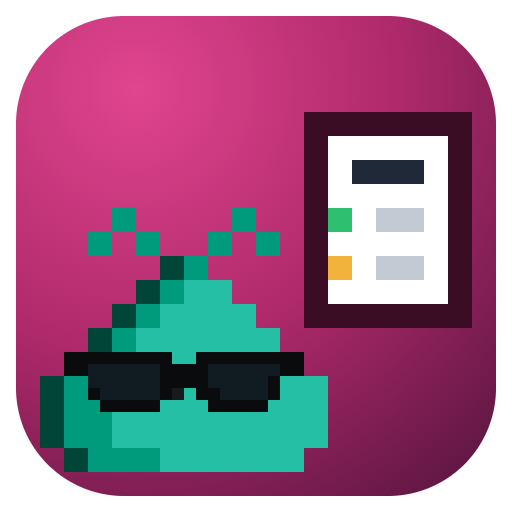
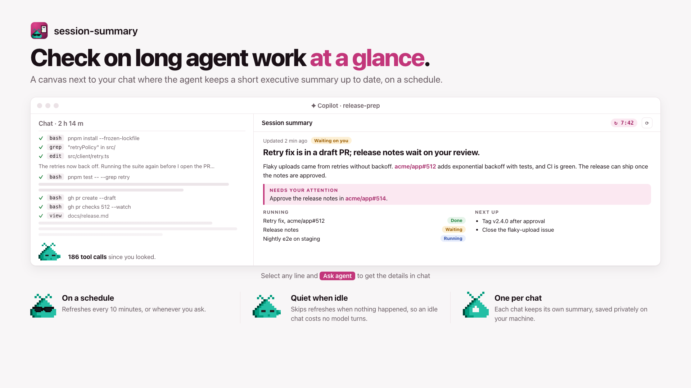

# Session summary

An executive summary of this chat's work that the agent keeps up to date on a
schedule. Built with [`@rwoll/canvas-kit`](https://github.com/rwoll/mono-oss/tree/main/packages/canvas-kit).

<picture>
  <source media="(prefers-color-scheme: dark)" srcset="https://raw.githubusercontent.com/rwoll/mono-oss/main/docs/session-summary/hero-dark.png">
  
</picture>

```sh
copilot plugin marketplace add rwoll/mono-oss#stable
copilot plugin install kitchensink@rwoll
```

Ask the agent to open `session-executive-summary` with a stable instance ID, such
as `session-summary`.

- **Summary.** The agent writes it with `update_summary`: a headline, a status, a
  short Markdown executive summary of where things stand now, and what is running
  (including parked work), what needs you, recent progress, and next steps. It's
  written for someone coming back after hours or days: what changed since the last
  summary and what it waits on, opening with a few words on what the chat is
  about. Each refresh tells the agent what the last summary said and how long ago.
- **Catching you up.** The page records the summary you last read once the panel
  has been visible and focused for 3 seconds. When newer summaries came out since,
  the next refresh asks the agent to catch you up from the one you read. GitHub issue and pull request URLs show as short
  `owner/repo#42` links.
- **Refreshing.** The `refresh` job asks the agent for a new summary every 10
  minutes (1 minute to 1 day), and the refresh button asks at once. The clock in
  the header counts down to the next refresh; click it to turn **Auto-refresh** on
  or off or change the interval in minutes. Each request starts
  with `[session-summary-refresh:schedule]` or `[session-summary-refresh:manual]`.
  The agent pauses it with `update_job` `{"id":"refresh","enabled":false}` when the
  work is done, and resumes it when work starts again.
- **Skipping.** A scheduled refresh is skipped while the agent is idle and has done
  nothing since the last summary, and when the agent wrote one on its own within
  the last half interval. Turn off **Skip when idle** to refresh regardless. A request the agent finishes a turn without answering, or never picks
  up within 15 minutes, is reported, and the next refresh asks again.
- **Asking about the summary.** Select text in the summary, then click **Ask agent**
  (or press **Alt+Enter**), write a question, and click **Send to agent**
  (**Ctrl+Enter** or **Cmd+Enter**). The passage is captured when you select it, and
  is sent with your question to the chat, queued behind the agent's current turn,
  as a `[session-summary-question]` message. The agent answers in chat. Selections
  up to 20,000 characters and questions up to 4,000 are accepted; longer ones are
  refused, not cut. A failed send keeps your question for a retry.
- **Storage.** Each chat has its own summary, saved privately under
  `<copilot-home>/extension-data/session-executive-summary/`.

Files:

- `canvas.ts`: the state, the agent and UI actions, and the refresh job.
- `App.tsx`, `AskAgent.tsx`, `App.css`, `references.ts`: the React UI.
- `*.test.ts`: unit tests (Vitest). `*.spec.ts`: browser tests against the built
  plugin (Playwright).

From `oss/marketplace`: `pnpm dev` previews it in a browser, `pnpm check` builds and
runs the unit tests, and `pnpm e2e` runs the browser tests after
`pnpm playwright:install`.
