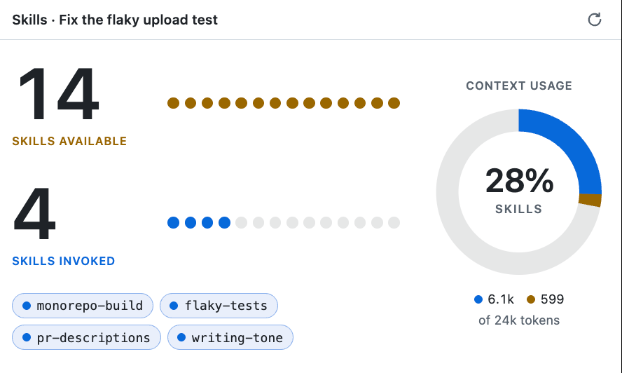

# Skill funnel

A picture of the skills in a Copilot session: how many were available, which of
them the agent invoked, and how much of the agent's context they take. Built with
[`@rwoll/canvas-kit`](https://github.com/rwoll/mono-oss/tree/main/packages/canvas-kit).

<picture>
  <source media="(prefers-color-scheme: dark)" srcset="https://raw.githubusercontent.com/rwoll/mono-oss/main/docs/skill-funnel/canvas-dark.png">
  
</picture>

The picture uses an invented session.

```sh
copilot plugin marketplace add rwoll/mono-oss#stable
copilot plugin install kitchensink@rwoll
```

Ask the agent to open `rwoll-skill-funnel`. It shows the chat it is opened in;
open it with `{"session": "<session ID>"}` to show another session on this
machine.

- **Two rows.** Skills available and skills invoked, each with its count and a dot
  for every skill. A skill's dot is in the same place in both rows, and is lit in
  the second when the skill was invoked. Point at a dot for the skill's name and
  description. The invoked skills are named below the rows.
- **Context usage.** The whole wheel is the agent's context at its latest model
  call. The slices are what skills take of it, in the rows' colors: the
  instructions of invoked skills, and the list of available skills. The middle has
  the two together as a share, and the numbers under the wheel are tokens.
- **Live.** The page reads the session's log when it opens, again a moment after
  each thing the agent does, and when you click refresh.

## Where the numbers come from

The canvas reads the session's `events.jsonl`, in the `session-state` folder of
Copilot's home (`~/.copilot`, or `$COPILOT_HOME`), and nothing else.

| What | How it is known |
| --- | --- |
| Available | The system prompt lists each skill by name and description. |
| Invoked | The log has a `skill.invoked` event for the skill, which is when its full instructions are put in an agent's context: the agent asked for it, you did, or it came with an agent's setup. A skill whose instructions the log shows delivered to an agent counts too, since a log can miss its first events. |
| Context | Each model call records the size of its request, which is the whole wheel. The slices are estimates, at about four characters to a token, of the text the log has for the list of skills and for each skill the main agent invoked. A skill a sub-agent invoked is in that sub-agent's context, and is not in the wheel. Instructions from before the conversation was compacted are no longer counted. |

When a log is missing its start, it has no system prompt, so the canvas shows `?` for
the skills available and says so, rather than guess. The log does not record whether
the agent then followed an invoked skill's instructions, so the canvas does not say.

## Actions

| Action | For | What it does |
| --- | --- | --- |
| `refresh` | Agent and page | Reads the log again. Returns the two counts, the names of the invoked skills, and the wheel's numbers. |
| `get_state` | Agent | Every skill with its description and whether it was invoked. |
