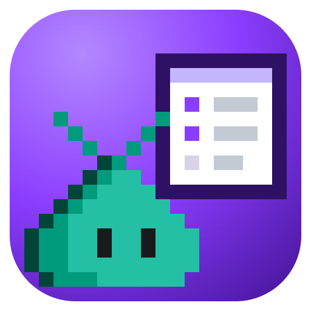

# canvas-kit

This plugin provides skills for building Copilot canvases with
[`@rwoll/canvas-kit`](https://github.com/rwoll/mono-oss/tree/main/packages/canvas-kit):

- [canvas-kit](https://github.com/rwoll/mono-oss/blob/main/marketplace/plugins/canvas-kit/skills/canvas-kit/SKILL.md): create or change a canvas: state,
  actions, React UI, saved documents, and scheduled jobs.
- [canvas-kit-testing](https://github.com/rwoll/mono-oss/blob/main/marketplace/plugins/canvas-kit/skills/canvas-kit-testing/SKILL.md): unit tests with Vitest
  and browser tests with Playwright.
- [canvas-kit-publishing](https://github.com/rwoll/mono-oss/blob/main/marketplace/plugins/canvas-kit/skills/canvas-kit-publishing/SKILL.md): publish canvases
  and other plugins as a marketplace with GitHub Actions.

It has no MCP servers, hooks, executable code, or package dependencies.

```sh
copilot plugin marketplace add rwoll/mono-oss#stable
copilot plugin install canvas-kit@rwoll
```
