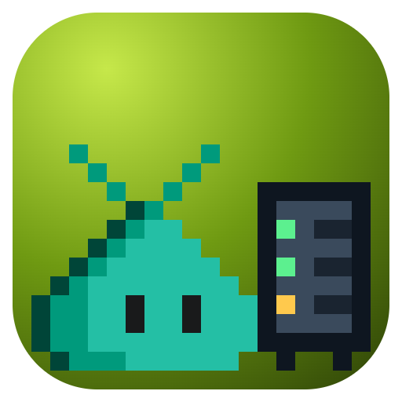
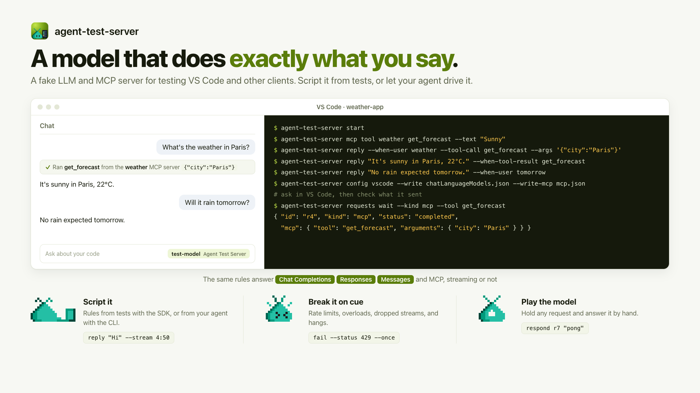

# agent-test-server

**A fake LLM and MCP server for testing the clients that talk to them, such as VS Code's
bring-your-own-key (BYOK) models. You decide every reply, failure, and tool call, from tests
with the SDK or from an agent with the CLI, and every request is logged so you can check what
the client sent.**

<picture>
  <source media="(prefers-color-scheme: dark)" srcset="https://raw.githubusercontent.com/rwoll/mono-oss/main/docs/agent-test-server/hero-dark.png">
  
</picture>

Testing a chat client against a real model is slow, costs money, needs keys, and gives a
different answer every run. This server answers the way you script it:

- **Three APIs from one script**: OpenAI Chat Completions, OpenAI Responses (including
  `previous_response_id`), and Anthropic Messages, streaming or not. Write a reply once, as
  text, reasoning, and tool calls, and the server encodes it for whichever API the request used.
- **Faults on cue**: HTTP errors in each API's own error shape with `Retry-After`, delays,
  streams that drop after N events, and requests that never answer.
- **A request log you can wait on**: headers, the raw body, and a normalized view of the
  messages and tools, for every request, including whether the client cancelled mid-stream.
- **Play the model**: hold a request and answer it by hand, from a test or the CLI.
- **Fake MCP servers**: declare tools with JSON Schema inputs and fixed or hand-written results,
  served over Streamable HTTP to both 2026 and 2025-era MCP clients.
- **Isolated sessions**: each session has its own API key, rules, log, and MCP servers, so
  parallel tests share one server without seeing each other.
- **VS Code configuration**: writes `chatLanguageModels.json` for the built-in Custom Endpoint
  provider and `mcp.json`.

The [`agent-test-server` skill](https://github.com/rwoll/mono-oss/blob/main/marketplace/skills/agent-test-server/SKILL.md)
in the [kitchensink Copilot plugin](https://github.com/rwoll/mono-oss/tree/main/marketplace)
teaches agents to use the CLI.

## Try it

You need Node.js 24 or later.

```sh
npm install -g --registry=https://registry.npmjs.org/ --min-release-age=7 --min-release-age-exclude='@rwoll/*' @rwoll/agent-test-server@latest

agent-test-server start                          # prints url, adminToken, session.apiKey, session.llmBaseUrl
agent-test-server reply "Hi! I'm a test model." --when-user hello
agent-test-server status
```

Then send it a request with any OpenAI or Anthropic client, using the session's
`llmBaseUrl` and `apiKey`:

```sh
curl -s "$LLM_BASE_URL/chat/completions" -H "authorization: Bearer $API_KEY" -H 'content-type: application/json' \
  -d '{"model":"test-model","messages":[{"role":"user","content":"hello"}]}'
agent-test-server requests                       # what it received
agent-test-server stop
```

`agent-test-server --help` lists every command. Every command prints JSON; `requests wait`
exits 3 when it times out, and usage errors exit 2.

## Use it with VS Code

```sh
agent-test-server models my-model --protocol responses --vision
agent-test-server mcp add weather
agent-test-server mcp tool weather get_forecast --text "Sunny"
agent-test-server config vscode --write <user-data-dir>/User/chatLanguageModels.json --write-mcp <user-data-dir>/User/mcp.json
```

`chatLanguageModels.json` gets a provider group for the Custom Endpoint provider
(`customendpoint`) built into VS Code's Copilot extension, with the session's API key and each
model's `apiType`: `chat-completions`, `responses`, or `messages`. `--protocol` points every
model at one API. The models show up in the chat's model picker.

When VS Code runs in a container or VM, such as a
[Blobby sandbox](https://github.com/rwoll/mono-oss/tree/main/packages/blobby-sandbox), listen on
every interface and say how the client reaches the server:

```sh
agent-test-server start --host 0.0.0.0 --port 4317 --public-url http://<address the client can reach>:4317
```

## Use it in a container or CI desktop

VS Code keeps a Custom Endpoint group's API key in its secret storage; the `apiKey` in
`chatLanguageModels.json` only points at it. So a VS Code that a script set up, such as a
signed-out one in a disposable container with no network, has no key to send. Its requests
arrive with an empty bearer token, the server answers 401, and the chat shows
"Incorrect API key provided".

When the server runs on the same machine as the client, start it with `--no-auth`:

```sh
agent-test-server start --no-auth       # prints "noAuth": true, and a warning on stderr
agent-test-server config vscode --write <user-data-dir>/User/chatLanguageModels.json   # written without apiKey
```

In no-auth mode:

- **LLM and MCP requests don't need a session API key.** At the server's root URL, a request
  with no key, an empty key, or an unknown key goes to the `default` session, the one `start`
  creates. It is always the default; no other session can take its place. A request that carries
  another session's key goes to that session, and so does one to that session's own URL
  (`/s/<id>/...`), with or without the key. Tests that use several sessions keep working.
- **It only listens on loopback.** `start --no-auth` refuses any `--host` other than
  `127.0.0.1`, `::1`, or `localhost`, and there is no override: without keys, anyone who can
  reach the port could use the server and fill its request log. To serve other machines, keep
  API keys on.
- **The admin API still needs the admin token.**
- **You can tell it's on.** Responses carry `x-agent-test-server-no-auth: 1`, `status` reports
  `noAuth: true`, and the request log marks each request that came without its session's key
  with `unauthenticated: true`.

From the SDK, pass `startServer({ noAuth: true })`.

## Use it with the Copilot SDK

Pass the session as a BYOK provider to `@github/copilot-sdk`. All three APIs work, streaming or
not, including tool calls to the session's own tools:

```ts
import { CopilotClient, approveAll } from '@github/copilot-sdk'

const { llmBaseUrl, baseUrl, apiKey } = await session.info()
const copilot = await new CopilotClient({ useLoggedInUser: false }).createSession({
  model: 'test-model',
  provider: { type: 'openai', wireApi: 'responses', baseUrl: llmBaseUrl, apiKey },
  // or { type: 'openai', wireApi: 'completions', ... }, or { type: 'anthropic', baseUrl, apiKey }
  onPermissionRequest: approveAll,
})
await copilot.sendAndWait({ prompt: 'What is the weather in Paris?' })
```

No GitHub sign-in is needed. Note that the `anthropic` provider takes `baseUrl`, without `/v1`.

## Script replies

Rules match in order, and fallback rules (`otherwise()`, `--fallback`) last. A rule's `when`
can check:

| Condition | Matches when |
| --- | --- |
| `lastUserMessage` | The request ends with a user message whose text contains a string, matches `{ "regex" }`, or `{ "equals" }`. A request that ends with a tool result doesn't match, so the rule doesn't fire again on the next turn. |
| `toolResult` | The request ends with a result for this tool. |
| `hasTool` | The request offers this tool. |
| `model`, `protocol`, `system` | The model ID, the API (`chat`, `responses`, `messages`), or the system prompt. |
| `nth` | The session's nth LLM request. |

Tool names also match the end of a prefixed name: `get_forecast` matches the
`mcp_weather_get_forecast` a client offers, and a reply's tool call uses the name from the
request. `times` limits a rule, and `hold` holds matching requests until you respond.

A request that no rule matches gets a reply saying so, by default. Set `unmatched` to `error`
to fail it with HTTP 500, or to `manual` to hold it for you to answer. The built-in models
`echo`, `fail-429`, `fail-500`, `hang`, and `slow` need no rules.

Scenario files hold models, rules, and MCP servers as JSON (`agent-test-server schema` prints
the JSON Schema):

```json
{
  "models": [{ "id": "test-model", "protocol": "messages", "thinking": true }],
  "rules": [
    {
      "when": { "lastUserMessage": "weather" },
      "reply": { "parts": [{ "reasoning": "They want the forecast." }, { "toolCall": { "name": "get_forecast", "arguments": { "city": "Paris" } } }] }
    },
    {
      "when": { "toolResult": "get_forecast" },
      "reply": { "parts": [{ "text": "Sunny, 22°C." }], "stream": { "chunkChars": 4, "delayMs": 30 } }
    },
    { "when": {}, "times": 1, "reply": { "fail": { "status": 429, "retryAfter": 2 } } }
  ],
  "mcpServers": [{ "name": "weather", "tools": [{ "name": "get_forecast", "result": { "text": "Sunny" } }] }]
}
```

Load one with `agent-test-server load scenario.json`, `start --scenario scenario.json`, or
`session.load()`.

## From tests

```sh
npm install -D --registry=https://registry.npmjs.org/ --min-release-age=7 --min-release-age-exclude='@rwoll/*' @rwoll/agent-test-server@latest
```

```ts
import { startServer } from '@rwoll/agent-test-server'

await using server = await startServer()
const session = await server.createSession()
const { llmBaseUrl, apiKey } = await session.info()

await session.when({ lastUserMessage: 'weather' }).reply(r => r.toolCall('get_forecast', { city: 'Paris' }))
await session.when({ toolResult: 'get_forecast' }).reply(r => r.text('Sunny, 22°C.').stream({ chunkChars: 4 }))
await session.when().once().fail(429, { retryAfter: 1 })

// ... point the client under test at llmBaseUrl with apiKey, and act ...

const request = await session.waitForRequest({ hasTool: 'get_forecast' })
expect(request.llm?.request.system).toContain('You are')
```

`waitForRequest` returns the first matching request after the last one this session handle
waited for (or `mark()`), so a request that arrives before the wait starts still counts.
`waitForPending()` and `respond(id, reply)` play the model; `respond(id)` releases a held
request with its rule's reply.

`connect({ url, adminToken })` drives a server started elsewhere, such as by the CLI, with the
same API. The SDK and the CLI both use the server's admin API under `/_admin`, which needs the
admin token as a bearer token.

With Playwright Test, each test gets a fresh session on a server shared by the worker:

```ts
import { test as base, expect } from '@playwright/test'
import { agentTestServerFixtures, type AgentTestServerFixtures, type AgentTestServerWorkerFixtures } from '@rwoll/agent-test-server/playwright'

const test = base.extend<AgentTestServerFixtures, AgentTestServerWorkerFixtures>(agentTestServerFixtures)

test('answers', async ({ agentSession }) => {
  await agentSession.otherwise().reply('Hi!')
  // ...
})
```

## Fake MCP servers

Each MCP server lives at `<session base URL>/mcp/<name>` and serves Streamable HTTP. Tools
take a JSON Schema for their arguments and answer with fixed text, MCP content blocks,
structured content, or an error. A `manual` tool holds each call until `respondMcp(id, result)`
or `agent-test-server respond <id>` answers it.

```ts
const weather = await session.addMcpServer('weather', [
  { name: 'get_forecast', inputSchema: { type: 'object', properties: { city: { type: 'string' } } }, result: { text: 'Sunny' } },
])
const call = await weather.waitForToolCall('get_forecast')
```

The log records `initialize`, `tools/list`, and every `tools/call` with its arguments and result.

## Limitations

- Chat Completions replies leave out reasoning, since that API has no standard field for it.
- 2025-era MCP clients are served statelessly, without `tools/list_changed` notifications or
  the standalone GET stream.
- MCP servers don't ask for authorization yet, and the server doesn't speak Ollama's or
  Gemini's APIs.
- Replies can't contain images.

## License

[MIT](https://github.com/rwoll/mono-oss/blob/main/LICENSE)
