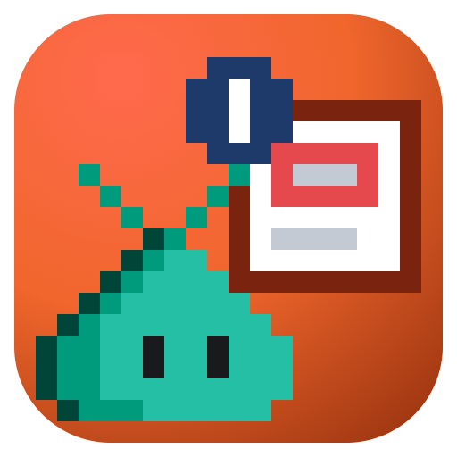
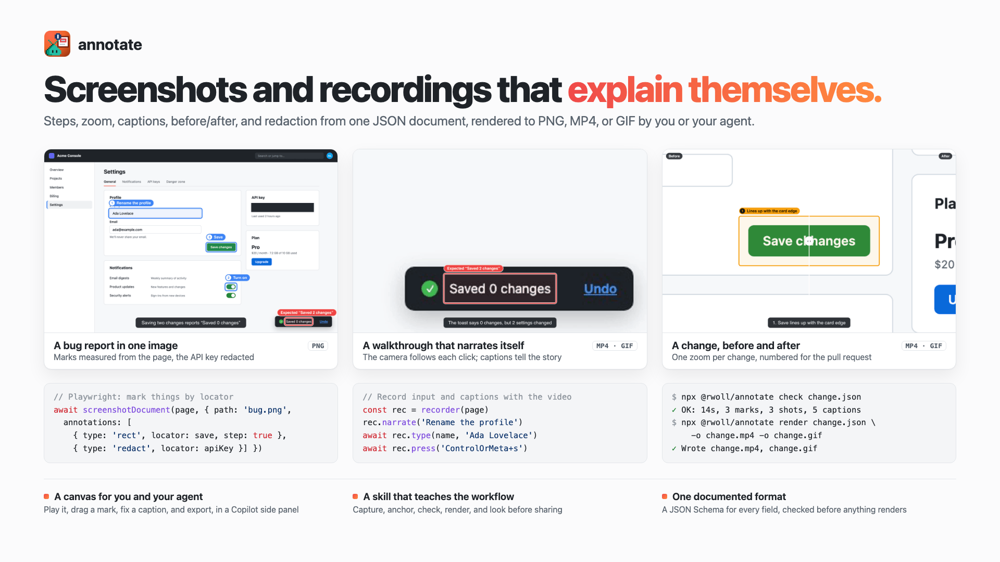
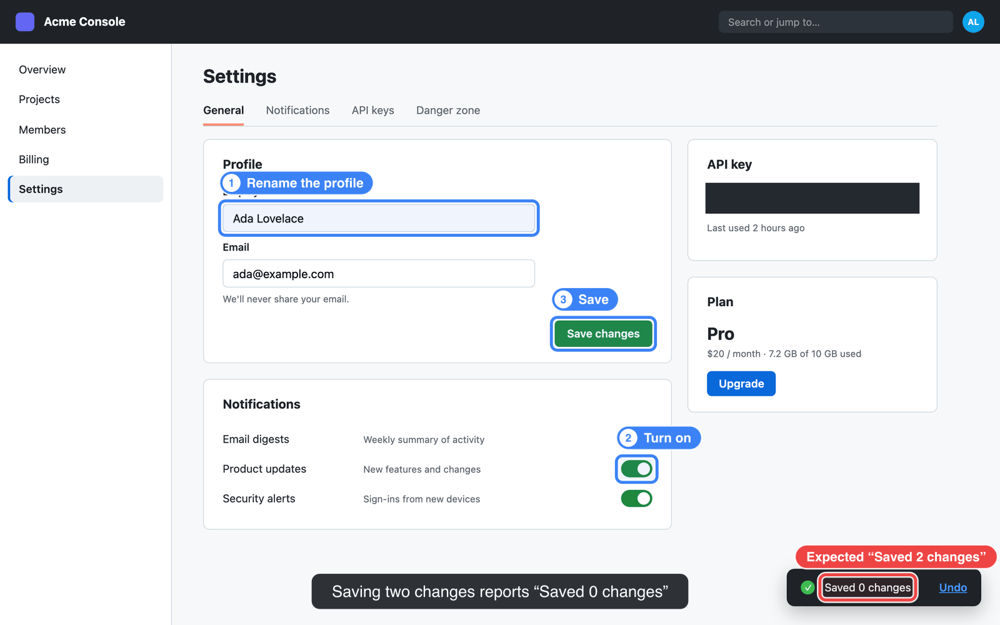
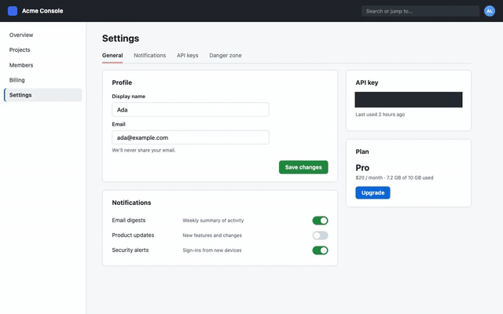
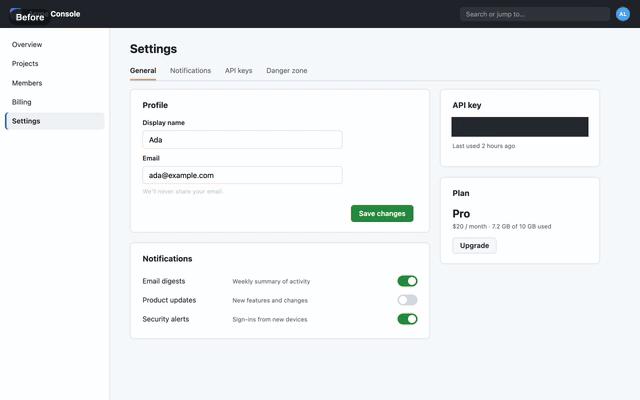

# @rwoll/annotate

**Screenshots and screen recordings that explain themselves.** Describe the marks
once, in JSON: numbered steps, boxes and arrows, zoom that follows the action,
captions, a before/after wipe, and redaction. Render it to PNG, MP4, or GIF, or play
it in the browser. For anyone, person or agent, who needs to show a UI problem or
change instead of describing it.

<picture>
  <source media="(prefers-color-scheme: dark)" srcset="https://raw.githubusercontent.com/rwoll/mono-oss/main/docs/annotate/hero-dark.png">
  
</picture>

- **One document, every output.** The same JSON renders to a PNG or MP4 and plays
  interactively, with the same layout everywhere.
- **Made for agents.** Marks anchor to Playwright locators, `annotate check` catches
  mistakes before anything renders, and `annotate grid` lets a model read positions
  off a screenshot.
- **Silent videos that explain themselves.** Captions are timed to reading speed,
  burned in or added as a subtitle track, and exported as WebVTT, SRT, or a
  Markdown transcript.
- **Redaction that holds.** Hidden pixels are replaced in the source before the
  camera, a magnifier, or an export ever sees them.

## Install

Install the `annotate` command globally, from the public npm registry. Its
dependencies install only once they've been published for 7 days; `@rwoll/*`
packages skip that cooldown. It needs npm 11.17 or later, which enforces both.

```sh
npm install -g --registry=https://registry.npmjs.org/ --min-release-age=7 --min-release-age-exclude='@rwoll/*' @rwoll/annotate@latest
```

```sh
annotate init shot.png                 # writes shot.annotate.json
annotate check shot.annotate.json
annotate render shot.annotate.json -o shot-annotated.png
```

Video needs [ffmpeg](https://ffmpeg.org/download.html) on `PATH` (or `--ffmpeg`, or
`ANNOTATE_FFMPEG`); stills do not. Requires Node.js 24 or later. In Copilot, the
annotate skill installs it for you with its `scripts/install-tools.ts`.

Can't reach registry.npmjs.org? Each [release](https://github.com/rwoll/mono-oss/releases)
has a tarball that installs without it. This takes the other dependencies from
Microsoft's public 1ES mirror of npm, which needs no token:

```sh
npm install -g --min-release-age=7 \
  --registry=https://ms-feed-25.pkgs.visualstudio.com/1es-public/_packaging/npm-public/npm/registry/ \
  https://github.com/rwoll/mono-oss/releases/download/annotate%400.1.0/rwoll-annotate-0.1.0.tgz
```

The skill's `scripts/install-tools.ts` does the same when registry.npmjs.org doesn't answer.

## Examples

All three come from the same settings page, which has a bug: saving two changes
reports "Saved 0 changes".

### A bug report in one image



Each mark is measured from a Playwright locator, so it lines up at any device pixel
ratio. Steps number themselves, labels and the caption stay clear of the marks, and
the API key's pixels are replaced before anything else is drawn.

```ts
import { screenshotDocument } from '@rwoll/annotate/playwright'

await screenshotDocument(page, {
  path: 'bug.png',
  annotations: [
    { type: 'rect', locator: page.getByLabel('Display name'), step: true, label: 'Rename the profile' },
    { type: 'rect', locator: page.getByRole('switch', { name: 'Product updates' }), step: true, label: 'Turn on' },
    { type: 'rect', locator: page.getByRole('button', { name: 'Save changes' }), step: true, label: 'Save' },
    { type: 'rect', locator: page.getByText('Saved 0 changes'), tone: 'problem', label: 'Expected “Saved 2 changes”' },
    { type: 'redact', locator: page.getByTestId('api-key') },
  ],
  narration: [{ t: 0, text: 'Saving two changes reports “Saved 0 changes”' }],
})
```

```sh
annotate render bug.annotate.json -o bug-annotated.png
```

### A walkthrough that narrates itself



The recorder notes every click, keystroke, and caption while Playwright records
the video. The camera follows them on its own: actions close together share a shot,
and far apart it pans straight from one to the next.

```ts
import { recorder } from '@rwoll/annotate/playwright'

const rec = recorder(page, { scale: 1 })   // right after the page opens
rec.narrate('Rename the profile')
await rec.type(page.getByLabel('Display name'), 'Ada Lovelace', { delay: 60 })
rec.narrate('Save with ⌘S')
await rec.press('ControlOrMeta+s')
const doc = rec.document({ path: await page.video()!.path() })
doc.annotations.push({ type: 'redact', box: await rec.box(page.getByTestId('api-key')) })
```

```sh
annotate render walkthrough.annotate.json -o walkthrough.mp4 -o walkthrough.gif
```

### A change, before and after



Two screenshots, one zoom per change, and the split parked on each. The last frame,
with every change numbered, makes a good still for the pull request description.

```jsonc
{
  "version": 1,
  "source": { "path": "after.png" },
  "compare": { "before": { "path": "before.png" }, "track": [[0.5, 0], [2, 1], [3.3, 0.5], [11.6, 0.5], [12.4, 1]] },
  "camera": [{ "type": "zoom", "time": [2.4, 5.6], "box": [1384, 800, 306, 108] } /* , one per change */],
  "annotations": [
    { "type": "rect", "box": [1384, 800, 306, 108], "tone": "changed", "step": true, "label": "Lines up with the card edge", "time": [3.2, 14] }
  ],
  "narration": [{ "t": 2.6, "text": "1. Save lines up with the card edge" }]
}
```

```sh
annotate init after.png --before before.png -o change.annotate.json
annotate render change.annotate.json -o change.mp4 -o change.png
```

### In Copilot

The `annotate` plugin adds a skill that teaches the agent this workflow and a canvas
where you and the agent review a document together: play it, drag a mark, fix a
caption, and export.

```sh
copilot plugin marketplace add rwoll/mono-oss#stable
copilot plugin install annotate@rwoll
```

## The document

Coordinates are source pixels: the image's own pixels, which for a screenshot are
CSS pixels times the device pixel ratio. Times are seconds.

```json
{
  "version": 1,
  "source": { "path": "settings.png", "width": 1280, "height": 800 },
  "annotations": [
    { "id": "save", "type": "rect", "box": [740, 352, 136, 36], "tone": "problem", "label": "8 px short of the edge", "step": true },
    { "type": "measure", "from": [868, 372], "to": [900, 372] },
    { "type": "arrow", "from": [600, 470], "to": "save" },
    { "type": "magnify", "box": [256, 770, 200, 16], "into": [360, 600, 640, 110], "label": "Footer" },
    { "type": "redact", "box": [952, 210, 244, 24] }
  ],
  "narration": [{ "t": 0, "text": "The Save button sits 8 px inside the content edge" }]
}
```

| Part | What it does |
| --- | --- |
| `annotations` | `rect`, `ellipse`, `arrow`, `callout`, `step`, `guide`, `measure`, `spotlight`, `magnify`, `redact`, `clicks`, `keys`. Each can have an `id` (arrows and steps can point at it), a `time` window, and a `tone`: `problem`, `warning`, `changed`, `added`, `removed`, `note`, `success`, or `accent`. |
| `camera` | `zoom` shots onto a box, and `auto` zoom that follows the recorded `events`: events close together share a shot, and far apart the camera pans straight between them. The camera zooms about the point two shots share, so the subject does not drift. |
| `events` | Clicks, keys, and typing recorded with a video, for click ripples, key chips, and auto zoom. |
| `compare` | A before/after wipe between two images, with `[time, position]` keyframes. |
| `narration` | Captions: each needs a start `t`; it ends at the next caption or after its reading time. |
| `output` | Default `width`, `fps`, and `scale` (the size of marks and text). |

`annotate schema` prints the JSON Schema, also published as
`@rwoll/annotate/schema.json`.

## CLI

| Command | What it does |
| --- | --- |
| `annotate init <image\|video> [-o doc.json] [--before <image>]` | Starts a document with the media's size (and length) filled in. |
| `annotate check <doc.json> [--json]` | Validates it: unknown ids, marks outside the frame, captions too fast to read, redactions with a time window, missing media. Exits 1 on errors. |
| `annotate render <doc.json> -o <out> [-o <out>...]` | Renders `.png`, `.jpg`, `.webp`, `.avif` (a still `--at` a time, default the end) or `.mp4`, `.webm`, `.gif`. Options: `--width`, `--fps`, `--captions burn\|soft\|none`, `--vtt <file>`, `--ffmpeg <path>`, `--progress` (JSON lines on stderr). |
| `annotate grid <image> -o <out.png> [--step <px>]` | Draws a labeled coordinate grid over an image. |
| `annotate convert <video> -o <out.mp4>` | Re-encodes a recording, such as Playwright's WebM, as H.264 MP4, which plays everywhere (some browsers, including VS Code's, cannot open WebM). |
| `annotate captions <doc.json> [--format vtt\|srt\|md]` | Exports the captions. |
| `annotate schema` | Prints the JSON Schema. |

## Entry points

| Import | Runs in | What it has |
| --- | --- | --- |
| `@rwoll/annotate` | anywhere | `documentSchema`, `parseDocument`, `checkDocument`, `resolveDocument`, `frameAt` (one frame as SVG layers and raster steps), camera planning, `timeCues`, `toVtt`, `toSrt`, `toMarkdown` |
| `@rwoll/annotate/node` | Node.js | `render`, `probe`, `loadDocument`, `completeDocument`, `drawGrid`, `convertVideo`, `findFfmpeg` |
| `@rwoll/annotate/browser` | browser | `FrameView`, which draws frames into a container with a canvas and SVG |
| `@rwoll/annotate/react` | browser | `<AnnotatePlayer document src />` with the camera, captions toggle, scrubbing, and a draggable wipe; `overlay` draws editing handles |
| `@rwoll/annotate/playwright` | Playwright | `screenshotDocument`, `boxOf`, and `recorder` |

### From code

```ts
import { parseDocument, checkDocument } from '@rwoll/annotate'
import { render } from '@rwoll/annotate/node'

const doc = parseDocument(JSON.parse(text))
for (const issue of checkDocument(doc)) console.warn(`${issue.level}: ${issue.path}: ${issue.message}`)
await render(doc, { out: 'out/shot.png', baseDir: 'out' })
```

### With Playwright

The helpers take your `page` and locators (see the [examples](#examples)); this
package does not depend on Playwright. Two kinds of pixels are involved:

- **Screenshots** are in device pixels: CSS pixels times the device pixel ratio.
  `screenshotDocument` and `boxOf(page, locator)` measure in them.
- **Recordings** are in CSS pixels at any device pixel ratio, scaled down to
  `recordVideo.size` (by default, to fit 800×800). A size larger than the viewport
  is padded with gray, not sharper, so set it to the viewport size and create the
  recorder with `recorder(page, { scale: 1 })`. Measure marks on a recording with
  `rec.box(locator)`, never `boxOf`.

Create the recorder right after the page opens, so its clock matches the video.
Pass letters in lowercase (`ControlOrMeta+s`): Playwright sends `S` as the key `S`,
which a page listening for `s` ignores.

## How it renders

Each frame is built from the same layers, in the same order, in Node.js and in the
browser:

1. **Redaction** replaces source pixels, so nothing later can show them.
2. **Camera**: the frame is cropped and scaled with sub-pixel accuracy, so slow
   zooms do not jitter.
3. **Before/after**: the before image fills the frame left of the wipe.
4. **Under** (SVG): spotlight dimming and lens shadows.
5. **Lenses**: magnified regions of the redacted source.
6. **Over** (SVG): marks, labels, click ripples, key chips, and captions. Labels
   avoid each other, and captions move to the top when they would cover a mark.

In Node.js, [sharp](https://sharp.pixelplumbing.com/) composites the layers and
ffmpeg decodes and encodes video, streaming frames through pipes: MP4 is H.264
(yuv420p, faststart), WebM is VP9, and GIF uses a palette made from the frames.

## Dependencies

[`sharp`](https://www.npmjs.com/package/sharp) (prebuilt for each platform, with no
install scripts) and [`zod`](https://www.npmjs.com/package/zod). `react` is an
optional peer dependency for `@rwoll/annotate/react`. ffmpeg is used from your
system for video.
