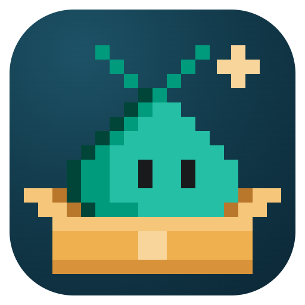
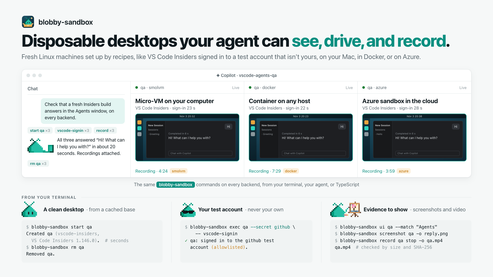

# Blobby Sandbox

**Give your agent a real desktop to test on: a fresh Linux machine, set up the same way every time by a
recipe, that it can see, drive, and record, and that you throw away when it's done. The default recipe
brings VS Code Insiders and a script that signs it in to a throwaway test account; yours can bring any
app.**

<picture>
  <source media="(prefers-color-scheme: dark)" srcset="https://raw.githubusercontent.com/rwoll/mono-oss/main/docs/blobby-sandbox/hero-dark.png">
  
</picture>

Agents can write code, but checking a UI change means clicking through an app the way a person would: open
the app, sign in, try the feature, take a screenshot. Doing that on your own computer puts your apps,
accounts, and tokens within the agent's reach, and every run inherits whatever the last one left behind.
Blobby Sandbox gives each run its own disposable machine instead:

- **A clean desktop every time**: Ubuntu with GNOME, Chrome, and developer tools, plus whatever its recipe
  installs. Later sandboxes start in seconds from the recipe's cached base.
- **Recipes for any app**: a recipe is a folder of scripts that install your app once, prepare it at every
  start, and sign it in to a test account. The default, `vscode-insiders`, brings the newest VS Code
  Insiders; [write your own](#write-your-own-recipe) for anything else.
- **Made for agents**: screenshots, mouse and keyboard input, the accessibility tree, and screen recordings,
  from one CLI where every command takes `--json`. Skills and a canvas plug it into Copilot.
- **Your credentials stay home**: a sandbox signs in only to a test account you allowlist, and never gets
  your environment, tokens, or files.
- **Runs where you do**: micro-VMs on your Mac or Linux box (smolvm), Docker, or Azure, with the same
  commands on each.

> **Status:** early. See [Known limitations](#known-limitations).

## Try it

You need Node.js 24 or later, and either a Mac with Apple silicon, Linux with KVM, or Docker. Install the
CLI, and on a Mac or Linux with KVM, `smolmachines` for the smolvm backend:

```sh
npm install -g --registry=https://registry.npmjs.org/ --min-release-age=7 --min-release-age-exclude='@rwoll/*' @rwoll/blobby-sandbox@latest smolmachines@1.31.0
```

Can't reach registry.npmjs.org? Install the [release's tarball](https://github.com/rwoll/mono-oss/releases)
instead, with other dependencies from Microsoft's public 1ES mirror of npm, which needs no token:

```sh
npm install -g --min-release-age=7 --registry=https://ms-feed-25.pkgs.visualstudio.com/1es-public/_packaging/npm-public/npm/registry/ \
  https://github.com/rwoll/mono-oss/releases/download/blobby-sandbox%400.1.1/rwoll-blobby-sandbox-0.1.1.tgz smolmachines@1.31.0
```

In Copilot, the blobby-sandbox skill's `scripts/install-tools.ts` does this for you. Then:

```sh
blobby-sandbox doctor                         # which backend it picked, and whether it works here
blobby-sandbox start demo --recipe desktop    # the first one installs a base: a few minutes, once
blobby-sandbox screenshot demo -o demo.png    # what's on its screen
blobby-sandbox view demo                      # or watch it live in your browser
blobby-sandbox rm demo
```

## Use it with VS Code Insiders

The default recipe, `vscode-insiders`, adds VS Code Insiders, and a built-in script signs it in to a GitHub
test account. Set the account up once, yourself. Use a **dedicated test account with an authenticator app
for its 2FA**, never your own: anything in the sandbox can use its session. Read the warning at the top
of the [reference](https://github.com/rwoll/mono-oss/blob/main/packages/blobby-sandbox/docs/reference.md) first.

```sh
mkdir -p ~/.config/blobby
# Only these logins get secrets.
echo '{ "allowedLogins": ["<login of a dedicated account, NOT your personal one, with no access to your orgs>"] }' > ~/.config/blobby/config.json
blobby-sandbox secrets set github             # asks for its login, password, and 2FA setup key
# or: blobby-sandbox secrets set github --file <path>   (JSON: username, password, totp_key; mode 600)
```

Then:

```sh
blobby-sandbox start qa --resolution 1600x1000             # VS Code Insiders, newest build, not signed in
blobby-sandbox exec qa --secret github -- vscode-signin    # signs it in, in about 20 seconds; retry once if it fails
blobby-sandbox exec qa -- vscode-open '~/'                 # open a folder in the sandbox
blobby-sandbox record qa start                             # ...drive it, then:
blobby-sandbox record qa stop -o qa.mp4
blobby-sandbox rm qa
```

## Write your own recipe

A recipe is a folder. Its `setup.sh` runs once, as root, to install a base that later sandboxes start from
in seconds; changing it makes a new base. This one adds Inkscape:

```sh
mkdir my-recipe
echo '{ "apiVersion": 1, "description": "Inkscape on the desktop" }' > my-recipe/recipe.json
echo 'apt-get update && apt-get install -y --no-install-recommends inkscape' > my-recipe/setup.sh

blobby-sandbox start art --recipe ./my-recipe    # installs its base: a few minutes, once
blobby-sandbox exec art -- inkscape --version
```

A recipe can also have a `boot.sh`, which runs at every start, and steps, which run when a sandbox is new
and can ask for a test account's secret to sign in. It all runs inside the sandbox, never on your computer,
so recipes are safe to share. See [Recipes](https://github.com/rwoll/mono-oss/blob/main/packages/blobby-sandbox/docs/reference.md#recipes), and the built-in
[`vscode-insiders`](https://github.com/rwoll/mono-oss/tree/main/packages/blobby-sandbox/recipes/vscode-insiders) recipe.

## Let your agent drive it

Install the Copilot plugin, with the CLI skill and a canvas to watch sandboxes, from the `rwoll` marketplace:

```sh
copilot plugin marketplace add rwoll/mono-oss#stable
copilot plugin install blobby-sandbox@rwoll
```

Then ask your agent, for example:

> Use the blobby-sandbox skill to reproduce `<issue URL>` in VS Code Insiders, and record it.


## Or from TypeScript

The CLI is a thin layer over the library, `@rwoll/blobby-sandbox`:

```ts
import { connect } from '@rwoll/blobby-sandbox'

const sandboxes = connect()                                // this computer's backend, as `doctor` reports
const sb = await sandboxes.start('qa')                     // the vscode-insiders recipe
await sb.exec(['vscode-signin'], { secret: 'github' })     // this process answers its requests for the account
const { png } = await sb.desktop.screenshot()
await sb.remove()
```

## Backends

| Backend | Where | Notes |
|---|---|---|
| **smolvm** | macOS on Apple silicon, or Linux with `/dev/kvm` | The default where it runs. Micro-VMs on your computer. |
| **docker** | Docker Desktop, or Docker Engine 20.10 or later | The default elsewhere. Needs 8 GB of memory and 20 GB of disk for Docker. |
| **azure** | Azure Container Apps sandboxes | Set up once with [`infra/azure`](https://github.com/rwoll/mono-oss/blob/main/packages/blobby-sandbox/infra/azure/README.md). No live viewer yet. |

Pick one with `--backend <name>` or `BLOBBY_SANDBOX_BACKEND`. Each backend has its own sandboxes.

## Known limitations

Each backend signs VS Code Insiders in to a test account, and its Agents window sends a message and gets a
reply. Beyond that:

- **Docker:** the agent can't run terminal commands when the test account's organization requires VS Code's
  command sandbox, which needs user namespaces and `/dev/net/tun` that Docker desktops don't get.
- **Azure:** no live viewer, as sandboxes take HTTP ingress only (use `screenshot` and `ui`), and desktops on
  restricted networks can't sign in yet: they don't trust the egress proxy's certificate. The Azure SDK
  it uses is still a beta.
- **smolvm:** sandboxes copied from a base have no deletion deadline, and a start can stall when another
  host ID owns the base.
- Every desktop operation is a separate command in the sandbox, which costs about 2 seconds per operation on
  Azure. A driver in the sandbox that keeps one connection open would cut that.

## Learn more

- [The reference](https://github.com/rwoll/mono-oss/blob/main/packages/blobby-sandbox/docs/reference.md): test accounts and secrets, recipes and scripts, desktop control, the
  SDK, each backend, and error codes.
- The [`blobby-sandbox` skill](https://github.com/rwoll/mono-oss/blob/main/marketplace/skills/blobby-sandbox/SKILL.md) and
  [canvas](https://github.com/rwoll/mono-oss/blob/main/marketplace/canvases/blobby-sandbox/README.md).

[RELEASING.md](https://github.com/rwoll/mono-oss/blob/main/RELEASING.md) covers how releases are made. [MIT](https://github.com/rwoll/mono-oss/blob/main/packages/blobby-sandbox/LICENSE) licensed. The Blobby sprites in
the logo and graphics come from [Visual Studio Code](https://github.com/microsoft/vscode), also MIT licensed;
see [their license](https://github.com/rwoll/mono-oss/blob/main/docs/blobby-sandbox/LICENSE-blobby-sprites.txt).
