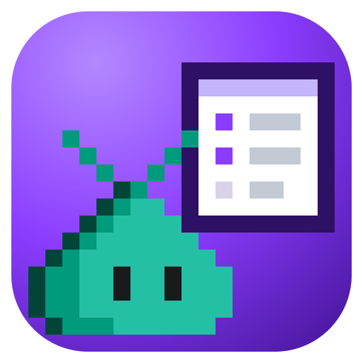

# @rwoll/create-canvas

Create a Copilot plugin marketplace repository with a TypeScript and React canvas,
built on [@rwoll/canvas-kit](https://github.com/rwoll/mono-oss/tree/main/packages/canvas-kit#readme).

```sh
npm create @rwoll/canvas my-marketplace -- --repository me/my-marketplace --canvas release-board
# or
pnpm create @rwoll/canvas my-marketplace --repository me/my-marketplace --canvas release-board
```

It writes `marketplace.config.json`, a pnpm workspace with install scripts disabled, a
shared `ui/` package of React components and a theme that every canvas uses, a
GitHub Actions workflow that publishes the marketplace to the `stable` branch on every
push to `main`, and a first canvas with unit and browser tests.
